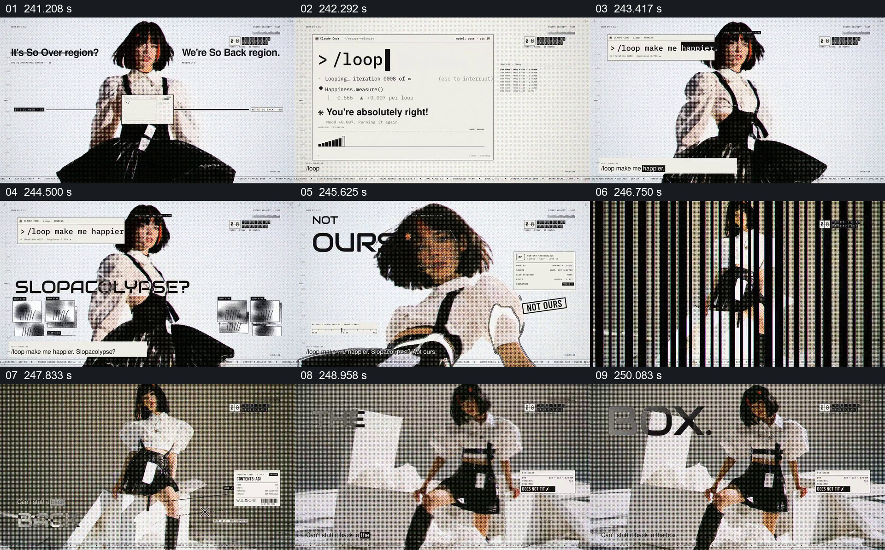

# 把循环命令、归属短句与装不回的盒子接起来

- 作品：案例 004《人物影像、服饰与图形标注》（索引名称）。
- 原片范围：04:01.000–04:11.000，含起点、不含终点；[完整原片](../video.mp4)｜[本卡片段](c19.mp4)。
- 观察方式：按整片 64 宫格及每秒一次真实源帧复核，抽看本段九个源帧；未连续原速观看或听审，快速切换和声音保持未知。

## 原画面具体怎样设计

浅色背景中出现类似终端的“/loop”命令和循环文字，人物在一旁；后续短句显示“NOT OURS”。随后人物坐在大盒子旁，周边有“CAN’T”“BOX”等大字与标签，白色包装材料散在盒子外。

## 为什么这样设计，好在哪里

界面中的命令、归属短句和实体盒子把抽象的控制问题转为几种可见载体；人物始终出现在附近，让这些符号围绕同一表演展开。片中所指的具体对象及因果需要声音和上下文才能进一步确认。

以上为依据画面的分析，非作者自述；预期观看效果未经观众测试。

## 可直接使用的创意指令

当讨论一个过程是否可控或能否恢复时，先用可读的界面或文字说明正在重复的动作，再以同一主体和一个有关的实体容器展示变化后的状态，最后用内容支持的短句提出问题或结论。若关系属于比喻，应明确它是比喻；真实控制权和不可逆性须由证据说明。
