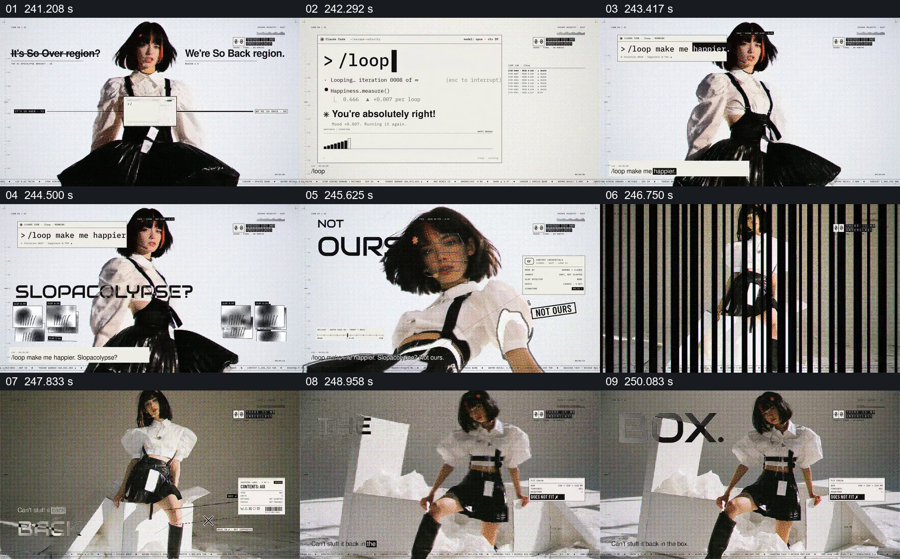

# 把循环命令、归属声明与装不回的盒子接成一段

- 作品：案例 004《人物影像、服饰与图形标注》，为原库索引名称。
- 原片范围：04:01.000–04:11.000，含起点、不含终点；[完整原片](../video.mp4)｜[本卡片段](c19.mp4)。
- 范围依据：从相反判断后的终端命令开始，至人物与盒子形成结果；之后回到全片反复出现的口号。 范围与已有创意切片一致，复用既有切片和分镜。
- 观察方式与未确认范围：查看原片 64 帧总览和本卡九宫格；对原先未建卡的 74–98、164–184、250–275 秒补看逐秒源帧。未独立连续原速观看或听审，抽帧间动作、准确速度和声音配合仍待复核。画面中的数字、判断和界面均是作品呈现，设计价值为分析而非作者自述。

## 原画面具体怎样设计

浅色背景中人物与两侧的相反区域文字同框，随后中央放大终端窗口，输入“/loop make me happier”，窗口内显示循环次数和条形指标。窗口缩到上方后，人物重新成为主要对象，命令仍停留在画面一角；下方出现 SLOPACOLYPSE 与一组小样图。

随后人物近景配“NOT OURS”字样和类似内容凭证的小卡，画面短暂被黑色竖条分隔；再切到人物坐在白色盒子和包装物中，后方巨字为 THE BOX，旁侧小卡写“DOES NOT FIT”。盒子和人物并置，形成该段最后的具体对象关系。

## 为什么这样设计，好在哪里

窗口里的循环先让抽象的重复行为有明确对象，人物重新出现时命令仍在一旁，观众能把人物与系统状态联系起来。归属声明之后，盒子提供一个物理上的结果画面；如果只保留终端和口号，就缺少“装不回去”这个可直接看到的比喻。

这些命令、情绪指标和归属凭证都属于作品中的示意；不能凭界面认定程序真实运行或内容来源已验证。

## 完整照排指令

以[完整原片](../video.mp4)的 241–251 秒为准。画幅 1280×720，源帧率 24/1。以下拍点为抽帧定位，位置按画幅百分比取近似值。

### 用料

- 【命令文字】【循环回复】【循环图】【质疑标题】【归属声明】【盒子标题】【系统票字段】各给可现场排印的短文。用【命令文字】贯穿独立界面及随后人物镜头。命令、回复和图之间要有可解释的关联，虚构界面按剧情呈现。引用真实系统回复时提供可打开的会话记录及定位。
- 【人物低机位】【盒旁站姿】【操作分镜组】【操作主镜】【失序近景】用同一人物和黑白造型。盒旁、操作组与操作主镜用同一只白盒或能匹配尺寸、盖口、折痕的布景。备同一次尝试的手、盒口、重新放入及人物动作。

### 按源时刻摆放

1. **241.000–约 243.000 秒。** 整幅浅灰工作界面中，左侧接近三分之二宽的白窗用薄灰线描边。左上左齐排列黑等宽【命令文字】，先只露前缀和光标，再逐字补完。下部排较小黑色【循环回复】和短幅【循环图】，右边另留细日志列。
2. **约 243.000–246.500 秒。** 硬切【人物低机位】，白底与前页接色，黑裙在画底展开，人物居中；上方薄浅条保留同名【命令文字】。中途黑宽体【质疑标题】跨左中，底下并列数块小预览，轮廓压低，右侧薄票排【系统票字段】。随后近景转成大号两行【归属声明】，文字贴左，和右半侧脸组成两块。小预览只在质疑拍内可见，可用静态状态，保留参考物和文字的对应。
3. **约 247.000–250.000 秒。** 【盒旁站姿】把人物缩为全身，用白盒与纸面在脚下围出场地，左端靠底排首个词。切白底六格【操作分镜组】，三列两行，按手触、盒口、人物反应的关系排，左上黑底白字短标。再以【操作主镜】接走，人物与盒同场，让后续【盒子标题】的大黑字从构图背面露出。格内若为视频，从约 248 秒六格出现到约 249 秒主镜接管保留各自播放进度。若做静态，选同次动作的有序帧，勿将不同盒子的断口拼作一件。
4. **约 250.000–251.000 秒。** 【失序近景】用人物脸为中心，深浅放射折片从画边斜压向脸，右侧留小浅票；放射保持到切出。按 251.000 秒截断。

### 局部采用

只有命令与人物画面可用 241–约 246.5 秒。若只拍到完整的盒子尝试，可用约 247–251 秒，保留同一个盒子的分格与主镜。

### 验证状态

已对照逐秒原片画序并读回，核对命令进入人物画面、两行归属声明、六格在盒旁全身与操作主镜之间、放射切出。快速切点、六格的逐格运动、原速听看与换料待核。
