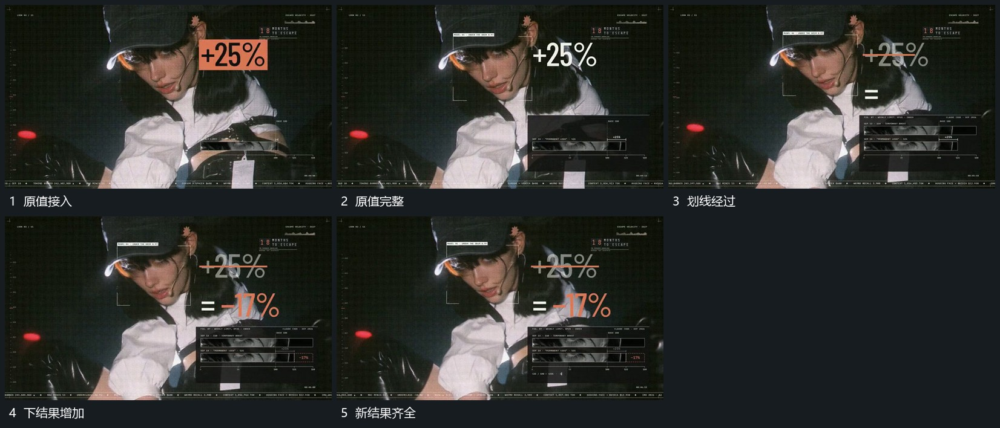

# 大数值先建立，划去原值后下方追加新结果

## 运动指令

在活动底层前接入大数值，完整保持后用短线经过原值。原值退弱，下方追加连接标记与新结果，底部小卡的短条随后更新，形成旧值到新值的清楚接续。

## 视频切片

[播放本机制的原片切片](m03.mp4)

覆盖分镜中“原值接入”至“新结果齐全”的连续过程，并保留邻近的前后衔接画面；原片中交叠发生的动作一并保留。

## 分镜过程

## 组合与调整

新片自行决定结果内容，动作顺序比原数字更重要。不要原值尚未建立就把替代值塞进同一位置。
