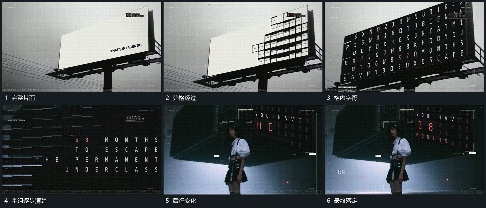

# 大片面分格接管，各槽字符轮换后分行落定

## 运动指令

让大片面从一侧显出格状边界，格面接管原平面。各槽中的字符轮换，短字组分行落定，未完成部分继续变化；活动底层接入后保留这一格面为后层。

## 视频切片

[播放本机制的原片切片](m04.mp4)

覆盖分镜中“完整片面”至“最终落定”的连续过程，并保留邻近的前后衔接画面；原片中交叠发生的动作一并保留。

## 分镜过程

## 组合与调整

不推定翻牌结构，保留可见分格与字符落定即可。格数和字数都可调整。
