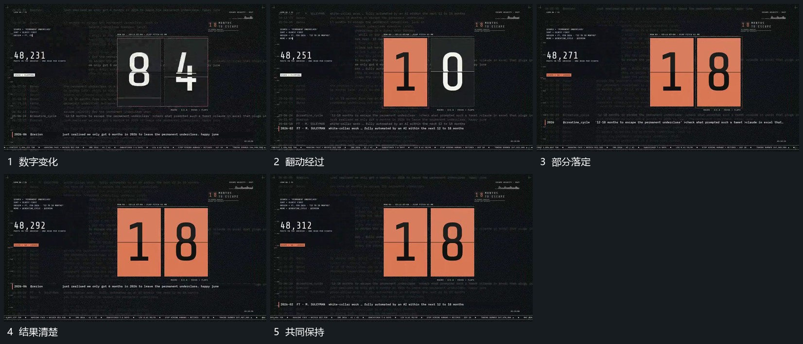

# 独立数字位上下翻动，到结果后共同保持

## 运动指令

把大数值拆成独立数字位，各位在自己的边界中上下翻动。更新期间可同时显出上旧下新的局部，部分位先落定，其余继续变化；最终全部停在清楚结果上。

## 视频切片

[播放本机制的原片切片](m05.mp4)

覆盖分镜中“数字变化”至“共同保持”的连续过程，并保留邻近的前后衔接画面；原片中交叠发生的动作一并保留。

## 分镜过程

## 组合与调整

可用平面遮罩实现同样关系，不要求原片结构。结果需要完整保持后再换镜。
