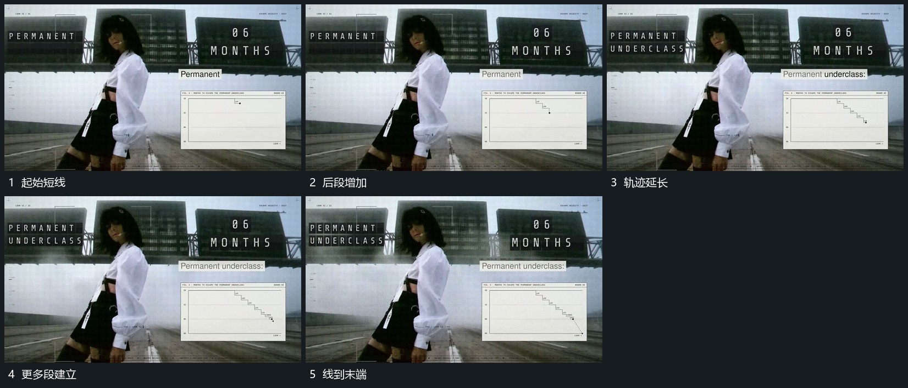

# 固定旁片内阶梯线逐段延长，端点接向下方

## 运动指令

保留旁侧片面，让阶梯线从起点逐段向下延长，横段与竖段交替接上，端点跟随新段移动。片外字组和活动底层继续保持，线到末端后稳定。

## 视频切片

[播放本机制的原片切片](m06.mp4)

覆盖分镜中“起始短线”至“线到末端”的连续过程，并保留邻近的前后衔接画面；原片中交叠发生的动作一并保留。

## 分镜过程

## 组合与调整

线形由本片材料决定，不让整图缩放冒充线段增长。
