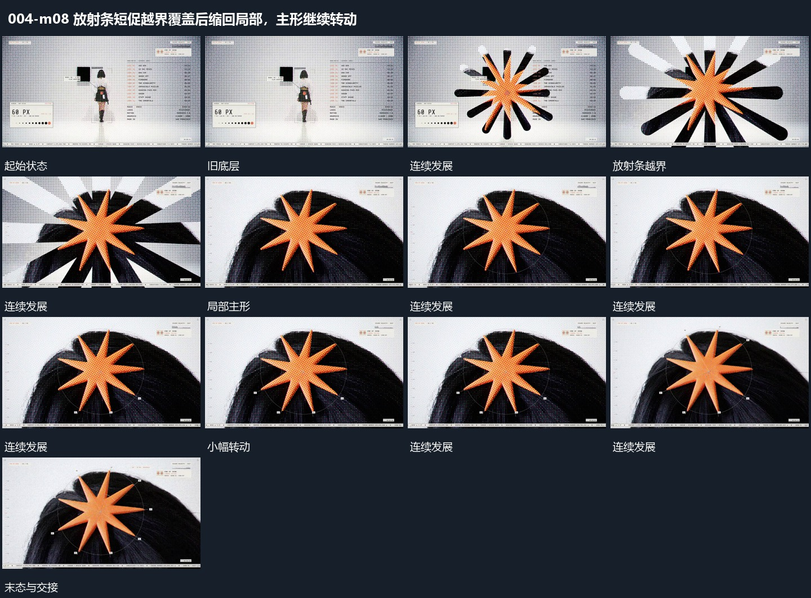

# 放射条短促越界覆盖后缩回局部，主形继续转动

## 运动指令

让放射条短促扩开到画面边缘，覆盖经过后缩回一个局部放射主形。局部主形继续小幅转动，外部细框与短标签逐项补入；底层保持可见，最后整体退出。

## 视频切片

[播放本机制的原片切片](m08.mp4)

覆盖分镜中“旧底层”至“标签补齐”的连续过程，并保留邻近的前后衔接画面；原片中交叠发生的动作一并保留。

## 分镜过程

## 组合与调整

局部接点需清楚，不能先全幅闪切再无来源出现标记。放射条可换为其他可收束图形。
