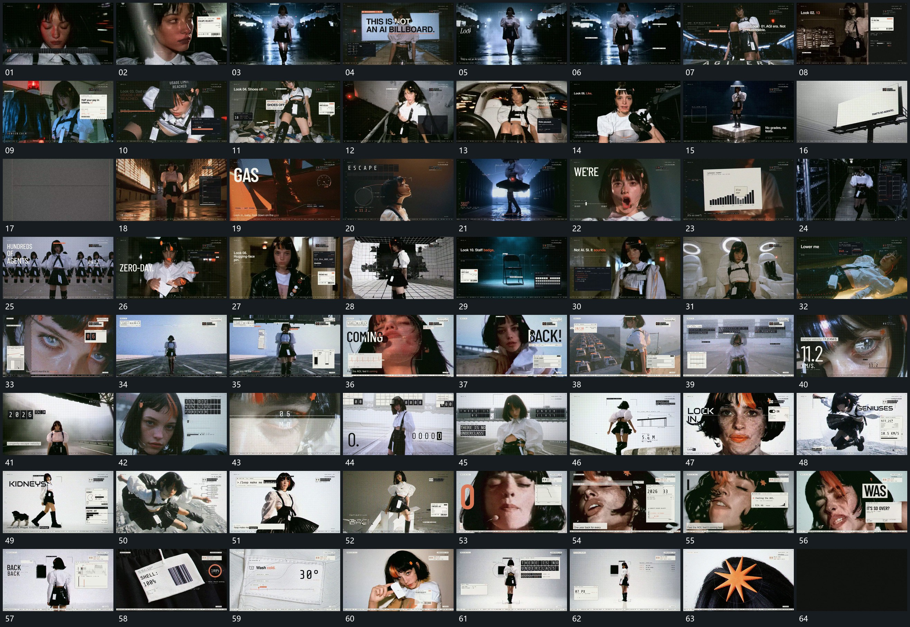

# 004｜原片运动总览

[观看完整原片](video.mp4)

## 运动总览

全片以连续活动材料为底层，多次切换底层而保留少量角框、短行和数字。开头 固定字槽字符快速轮换，逐段落定成清楚短行 让分格短行从杂乱字符逐步落成清楚字组，活动底层局部角框保持，旁卡与小条错峰补入 在局部角框旁追加短卡与数值条。中段反复用 大数值先建立，划去原值后下方追加新结果 建立大数值，画线划去后补入新结果；前层卡中的短条和局部指标随后更新。

大片面由完整平面切入分格面，大片面分格接管，各槽字符轮换后分行落定 让格内字符轮换并落定，随后回到活动底层，侧边卡继续接续。独立数字位上下翻动，到结果后共同保持 将分开的大数字位翻动到结果，固定旁片内阶梯线逐段延长，端点接向下方 在固定旁片内分段延长阶梯线。后半段反复沿用 固定字槽字符快速轮换，逐段落定成清楚短行 与 活动底层局部角框保持，旁卡与小条错峰补入，字片分批建立，图框、数字及短词原位更新；局部环线与分支线持续补齐。

末段 全画面细格逐渐粗化，旁侧数值更新 让全画面细小格点逐渐粗化，旁侧数值更新。放射条短促越界覆盖后缩回局部，主形继续转动 的放射条短促越界覆盖后缩回局部，局部主形再小幅转动，外部细框与短标签逐项补入，最后退暗。底层自身的行动不按题材逐个命名，本总览关注叠加层和画面交接。

## 完整运动段落

以下按原片中的出现顺序引用。建立、内部发展及完成反馈放在同一段中；同时发生的局部动作与运镜写在同一份指令里。不同段之间可以是连续接管，也可以是直接切换，不能仅凭条目相邻认定可直接拼接。重复出现的同类运动采用一次连续代表范围，切片不以逐段无缝覆盖整片为目标。

1. [固定字槽字符快速轮换，逐段落定成清楚短行](mechanisms/m01.md)：字符更新，槽位不动

2. [活动底层局部角框保持，旁卡与小条错峰补入](mechanisms/m02.md)：底层不断，前层分项建立

3. [大数值先建立，划去原值后下方追加新结果](mechanisms/m03.md)：先原值，后划线，再结果

4. [大片面分格接管，各槽字符轮换后分行落定](mechanisms/m04.md)：格边界先接管，内容随后变化

5. [独立数字位上下翻动，到结果后共同保持](mechanisms/m05.md)：各位更新，边界保持

6. [固定旁片内阶梯线逐段延长，端点接向下方](mechanisms/m06.md)：片面保持，线按段增长

7. [全画面细格逐渐粗化，旁侧数值更新](mechanisms/m07.md)：格尺度变化，前层指标接续

8. [放射条短促越界覆盖后缩回局部，主形继续转动](mechanisms/m08.md)：覆盖先扩开，再局部接管

切片保留起始准备、必要内部停顿和完成或明确交接；首尾省略无新发展的等待，持续运动不要求人为停住。以上基于真实源帧序列和重点边界核对，不等同于全片连续声画审片。

## 完整64宫格

