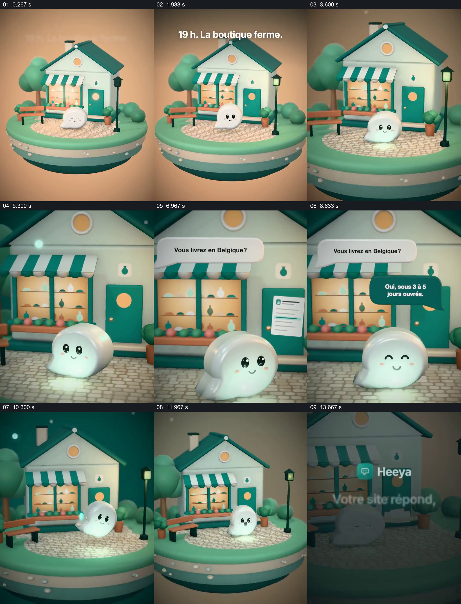

# 让打烊后的网站问答具体发生在熟悉的店门前

- 作品：案例 073《关店后的自动回复》（本次概括）。
- 原片范围：00:00.000–00:15.061，含起点、不含终点；[完整原片](../video.mp4)｜[本卡片段](../video.mp4)。
- 观察方式：依据约每秒一次的真实源帧观察，未连续原速观看或听审；声音、语气与完整播放节奏未确认。

## 原画面具体怎样设计

微型店铺处于画面中央，文字先标明晚上关店；小白色角色留在店前，镜头靠近后出现“配送到比利时吗”的问句，旁边出现文档样式的资料，随后回答气泡给出配送时间。画面回到店铺整体与角色，最后覆盖品牌和“店关了网站仍回答”的文字。

## 为什么这样设计，好在哪里

店铺关门是服务需要出现的具体情境；问题、资料提示与答案在同一空间接续，使抽象的自动回应有了可辨过程。答案和服务能力是片中展示，未核验。

以上为依据画面的分析，非作者自述；预期观看效果未经观众测试。

## 可直接使用的创意指令

介绍自动问答时，先建立用户实际无法及时回应的情境，再选一个有依据的常见问题，展示回答所依据的资料与可见回复，最后回到服务所承担的角色。配送时间等具体答案应来自当前真实资料，角色和场景按品牌调整。
