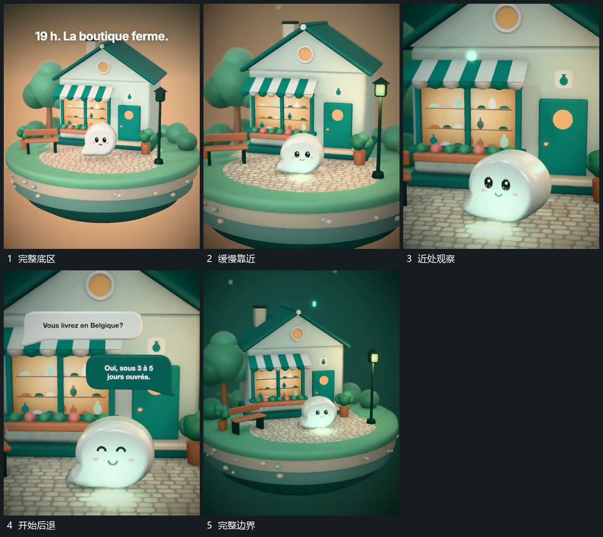

# 保持底区连续并缓慢推近转角再后退

## 运动指令

围绕同一底区持续靠近，同时少量改变观察角度，让近层与后层出现不同幅度的位移。前层主形的局部运动不中断。需要回到全貌时沿整体距离后退，使底区边界重新出现，而非只缩小某一个对象。

## 视频切片

[播放本机制的原片切片](m01.mp4)

覆盖分镜中“完整底区”至“完整边界”的连续过程，并保留邻近的前后衔接画面；原片中交叠发生的动作一并保留。

## 分镜过程

## 组合与调整

可取消转角只保留推退；空间内各层的相对位置要连续，避免退镜时重新拼摆。
