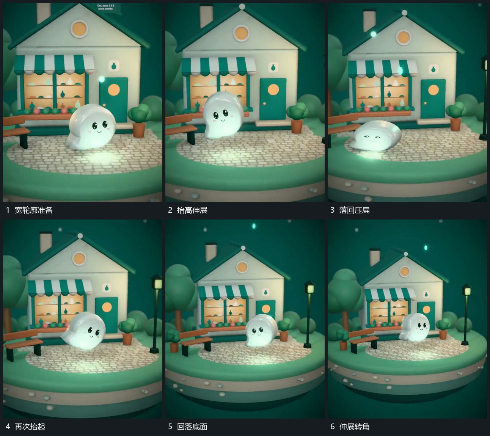

# 软轮廓先压扁再抬起倾斜并落回

## 运动指令

让主形底部先保持接触，外轮廓向两侧铺开并压低。随后整体抬起，上部伸长并带少量倾角，底部与底面短暂分离。下降时收回倾角，再次压扁后恢复。重复时沿同一小范围运动，不让底面跟着跳动。

## 视频切片

[播放本机制的原片切片](m02.mp4)

覆盖分镜中“宽轮廓准备”至“伸展转角”的连续过程，并保留邻近的前后衔接画面；原片中交叠发生的动作一并保留。

## 分镜过程

## 组合与调整

改变幅度与重复次数即可迁移；不要把压缩、抬起和落地拆成互不接续的效果。
