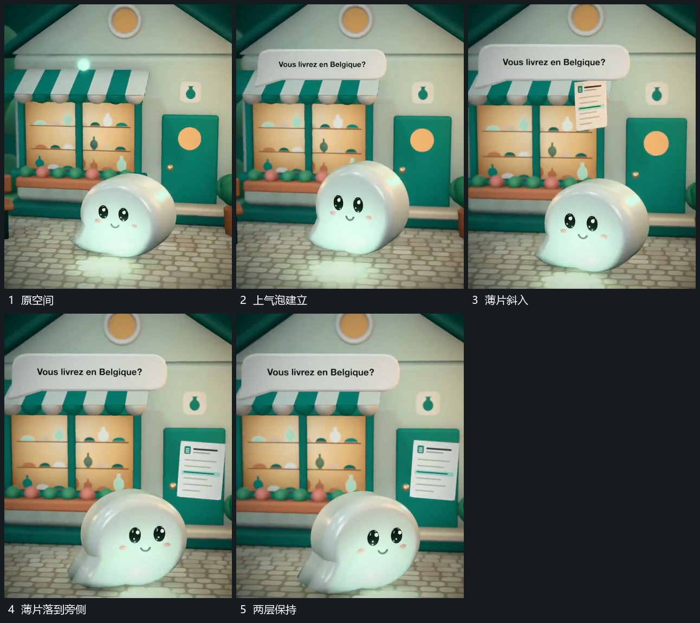

# 上方气泡先保持旁侧薄片再斜入

## 运动指令

在主形上方先建立带小尖角的框，框出现后位置保持。随后让小薄片从上方斜向进入，一边下降一边改变倾角，落到主形旁侧后减小位移并保持。主形的起伏和底区均继续，不为旁片重置场面。

## 视频切片

[播放本机制的原片切片](m03.mp4)

覆盖分镜中“原空间”至“两层保持”的连续过程，并保留邻近的前后衔接画面；原片中交叠发生的动作一并保留。

## 分镜过程

## 组合与调整

旁片可替换为任意小面；它应有独立入场路径，避免和上框同时从同一点弹出。
