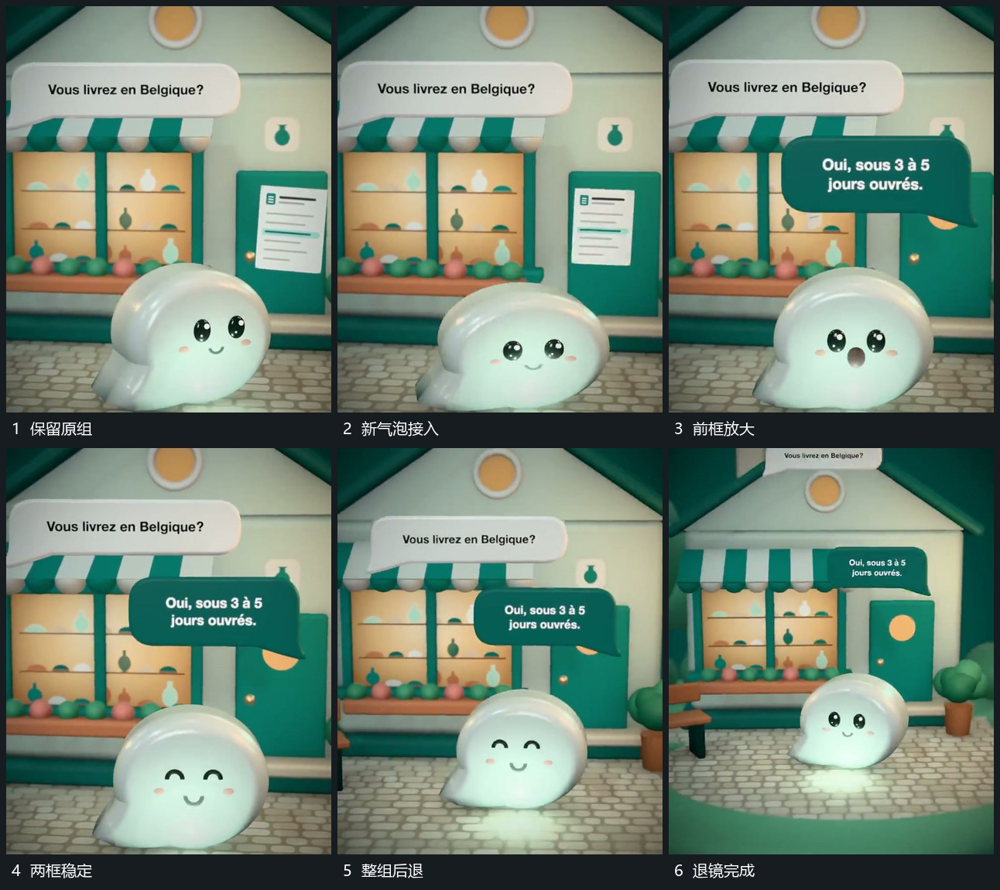

# 第二气泡放大接入后整组退镜

## 运动指令

保留上方气泡，在其下侧建立另一前层框。新框从较小范围展开到完整宽度，尖角保持朝向主形，完成后给两框短暂共同保持。随后镜头整体后退，气泡、主形和后层一起变小，维持原相对关系。

## 视频切片

[播放本机制的原片切片](m04.mp4)

覆盖分镜中“保留原组”至“退镜完成”的连续过程，并保留邻近的前后衔接画面；原片中交叠发生的动作一并保留。

## 分镜过程

## 组合与调整

适合先补一句再返回整体；退镜要作用于共同空间，不能只把两个框缩小。
