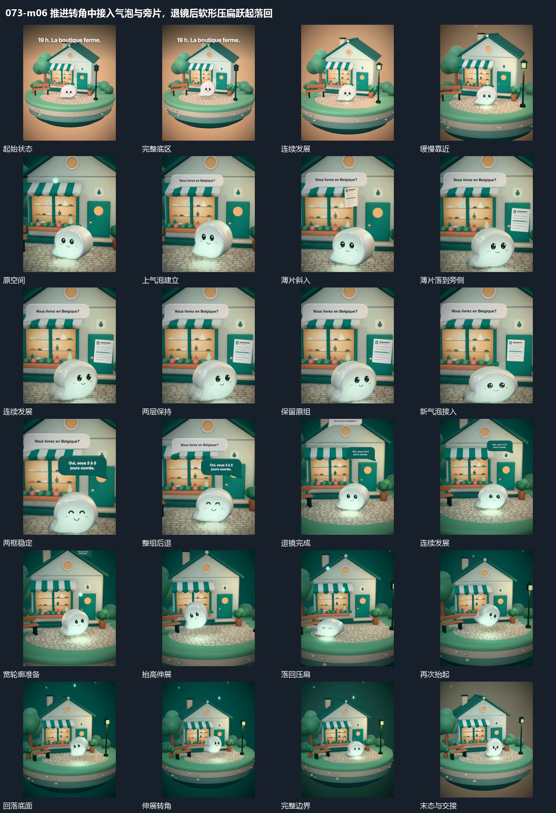

# 推进转角中接入气泡与旁片，退镜后软形压扁跃起落回

## 运动指令

起始：完整底区和前层主形。

1. 底区保持连续，镜头缓慢靠近并转角。

2. 上方气泡保持时旁片滑入，第二气泡扩大接上。

3. 整体退镜，软形压扁再跃起倾斜，最后落回。

上述镜头变化与局部动作按同一条连续过程推进；写明同时发生的步骤在原场面中交叠，不先完成整段运镜再重演局部。

## 视频切片

[播放本机制的原片切片](m06.mp4)

保留起始准备、连续发展和完成或明确交接；首尾按本段运动范围裁切，不拼接、不变速。相连的小动作合为同一完整段落。

## 分镜过程

## 组合与调整

保留以下动作关系：底区保持连续，镜头缓慢靠近并转角；上方气泡保持时旁片滑入，第二气泡扩大接上；整体退镜，软形压扁再跃起倾斜，最后落回。

可调整位移距离、层级间距、重复数量与相对快慢；已有锚点和未退出的层继续承接。连接下一段时以切片末态为起点，另行设计不连续的状态转换。
