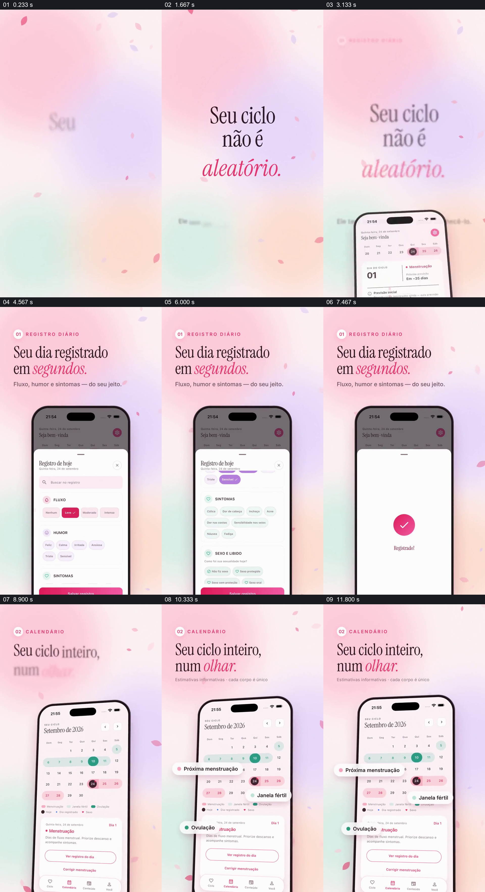

# 从一天的身体记录，展开到标注不同日期的周期日历

- 作品：案例 038《粉色手机与数据标记》（库内索引名称）。
- 原片范围：00:00.000–00:13.000，含起点、不含终点；[完整原片](../video.mp4)｜[本卡片段](c01.mp4)。
- 范围依据：从开场周期命题到记录、保存和日历标记；13 秒后转为音乐功能。
- 观察方式与未确认范围：查看整片 64 帧总览和本卡分镜。未独立完成连续原速观看与听审；抽帧之间的运动、停顿与声音配合待复核。画面中的界面、数字与说明是作品呈现，未经额外核实；设计价值为基于画面的分析。

## 原画面具体怎样设计

粉、紫、薄荷色渐变背景上散布花瓣，中央文字提出“你的周期并非随机”。一部手机从下方出现，标题换成“几秒记录一天”，手机上的记录表覆盖在主页上，流量、心情、症状等选项以不同颜色的标签展示；之后界面出现粉色对勾和已记录状态。

同一手机随后显示整月日历，日期方格中有粉色、浅绿和深绿等不同标记，屏幕外侧的白色小标签分别指向下一次月经、易孕窗口和排卵；下方仍可见对应日期的说明卡。画外标签帮助辨认手机内较小的颜色信息，渐变背景和花瓣持续保留。

## 为什么这样设计，好在哪里

先让一日记录有具体内容和明确保存结果，再将注意力转向日历，观众能够理解不同时间尺度上的信息如何呈现。将解释标签放到手机外侧，既不遮住日历主体，又把颜色与类别关联；但画面本身不足以证明一次提交就准确推导出后续日期。

周期预测只是画面中的提示，并非医学结论；具体数据、算法和准确性未核实。

## 可直接使用的创意指令

展示长期记录时，先用一个真实或明确标注的示例说明当天录入了什么，保留提交结果；随后展示一段时间内的日期视图，并在不遮挡原始信息的位置解释颜色、符号和估计值。标明哪些是用户记录、哪些是推测以及使用的时间范围。

可以用于运动、学习或健康日志，颜色与载体可换；涉及健康预测应保持不确定性，不能把估计结果写成诊断或保证。

本方法尚未在新题材中实测。
