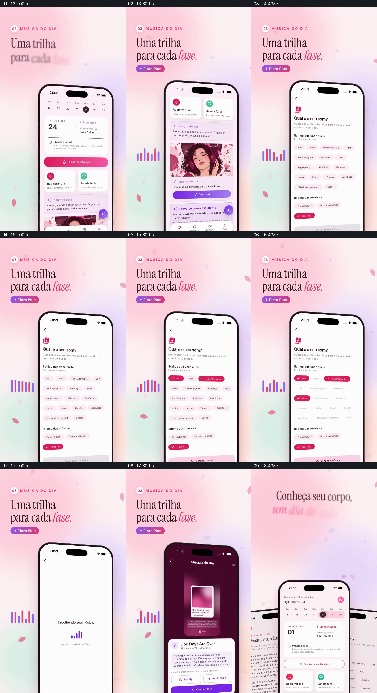

# 从当前状态进入偏好选择，再展示一条音乐推荐

- 作品：案例 038《粉色手机与数据标记》（库内索引名称）。
- 原片范围：00:13.000–00:19.000，含起点、不含终点；[完整原片](../video.mp4)｜[本卡片段](c02.mp4)。
- 范围依据：从当前阶段和音乐入口，到偏好选择、处理和歌曲结果；之后回到整片总结。
- 观察方式与未确认范围：查看整片 64 帧总览和本卡分镜。未独立完成连续原速观看与听审；抽帧之间的运动、停顿与声音配合待复核。画面中的界面、数字与说明是作品呈现，未经额外核实；设计价值为基于画面的分析。

## 原画面具体怎样设计

粉色渐变背景上，左上标题写“每个阶段的一条音乐”，手机主页显示周期第 24 天与当前阶段，往下可见“今日音乐”卡片；手机左侧出现彩色竖条图形。

手机切换到喜好表单，列出流行、独立音乐等多种风格和语言选项；不同抽帧中部分标签变为粉色，表示已选。接着白色屏幕显示正在选择音乐，结果页改为深紫色，出现歌曲封面、名称、说明及音乐平台按钮。标题和左侧彩条提供稳定参照，手机内的内容承担实际流程变化。

## 为什么这样设计，好在哪里

先交代当前阶段，再让观众看到主动选择的喜好，推荐结果因此有两个可理解的输入。处理中页面与最终歌曲卡分别给出过程和结果，而固定在画外的标题、彩条让手机内部可以更换多个界面而不丢失场面主题。

音乐推荐与周期阶段的实际关联、歌曲播放和算法效果均未核实，也未听审片中声音。

## 可直接使用的创意指令

展示推荐时，明确用户当前可见状态和真正参与选择的偏好，让选项、等待状态与具体推荐结果依次可见；结果卡应包含名称、来源和可执行入口。用固定标题或图形维持场面连续，同时避免让装饰性声音图形暗示未经验证的播放。

可迁移到文章、课程或运动建议；推荐依据和健康相关描述须有证据，示意操作应明确标注。

本方法尚未在新题材中实测。
