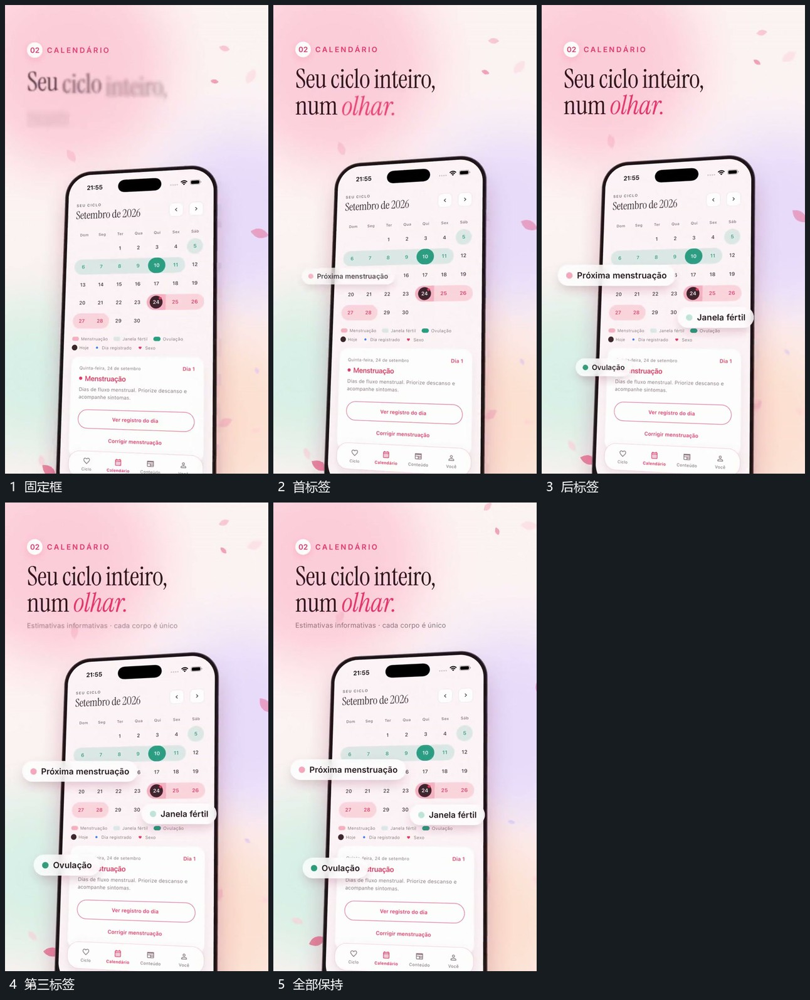

# 固定竖框局部短标签逐项提出到前层

## 运动指令

保留竖框与内部布局，从其中几个局部位置逐项提出短标签。标签在框前错开落位，后标签接入时前标签保持，内部来源继续可见。

## 视频切片

[播放本机制的原片切片](m03.mp4)

覆盖分镜中“固定框”至“全部保持”的连续过程，并保留邻近的前后衔接画面；原片中交叠发生的动作一并保留。

## 分镜过程

## 组合与调整

标签应靠近对应区域。可以换标签内容，不用写成具体交互功能。
