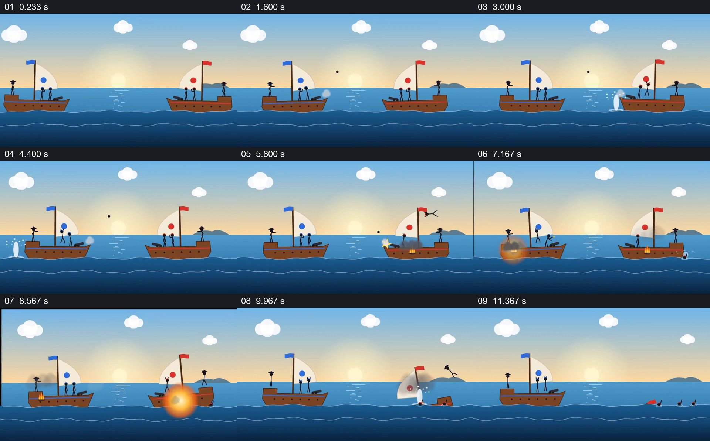

# 用同一远景中的两艘船交代交战与结果

- 作品：案例 076《两船海上交战》（本次概括）。
- 原片范围：00:00.000–00:12.522，含起点、不含终点；[完整原片](../video.mp4)｜[本卡片段](../video.mp4)。
- 观察方式：依据约每秒一次的真实源帧观察，未连续原速观看或听审；声音、语气与完整播放节奏未确认。

## 原画面具体怎样设计

宽幅海面上两艘船分别以蓝旗和红旗区分，船上小人、炮口及帆保持在可比较的位置；黑色弹丸和水花先后出现在两船之间，船身出现火光和损坏。红旗船一侧随后倾斜、解体，人员落水，蓝旗船仍留在海面，画面变暗结束。

## 为什么这样设计，好在哪里

固定远景保留双方位置，使弹丸、水花和船身变化能够联系到同一场交战；旗帜区分对象，沉没与留下的船清楚交代结果。抽帧不能确认每次射击的精确先后与声音。

以上为依据画面的分析，非作者自述；预期观看效果未经观众测试。

## 可直接使用的创意指令

需要以简洁画面讲清双方行动时，先用形状或标识区分参与者，在同一空间保留双方相对位置；让行动的路径、命中或偏离及对象状态变化逐次可见，最后保持足够时间展示双方结果。具体冲突、动作和表现风格根据故事设计。
