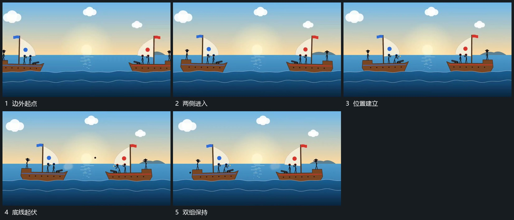

# 双组从两侧进入并随底线小幅起伏

## 运动指令

让两组承载形从左右两侧相向进入，到各自位置后减小横向移动。下方曲线持续起伏，两组随曲线作小幅升降，组内附属形保持相对位置。两组之间留出稳定间距，供后续小点经过。

## 视频切片

[播放本机制的原片切片](m01.mp4)

覆盖分镜中“边外起点”至“双组保持”的连续过程，并保留邻近的前后衔接画面；原片中交叠发生的动作一并保留。

## 分镜过程

## 组合与调整

可只保留一组，另一侧作为落点；两组的大幅入场结束后，底部起伏保持较小幅度。
