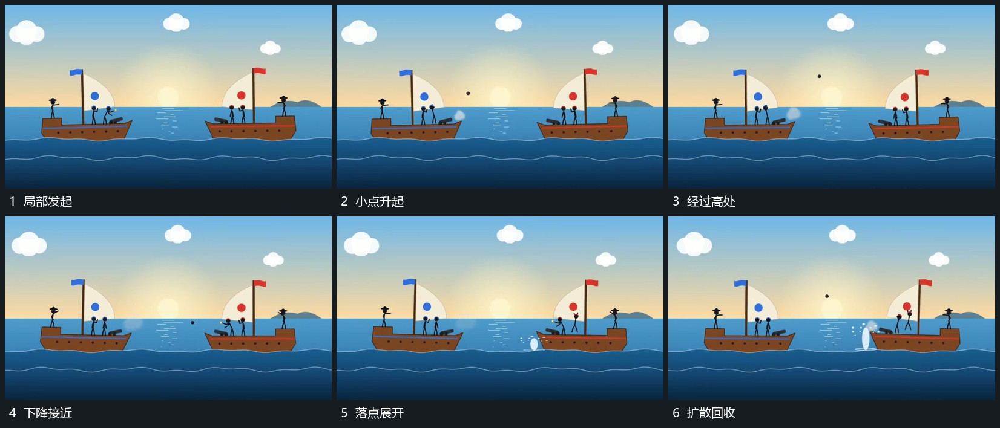

# 小点沿弧线跨越间距落点竖向扩散

## 运动指令

在一侧局部发起小点，让它先上升、跨过中间空区再下降。接近另一侧下缘时，小点退去，落点附近竖向片和细点短促向外展开，再收回底线附近。反向使用时镜像路径，双组位置不变。

## 视频切片

[播放本机制的原片切片](m02.mp4)

覆盖分镜中“局部发起”至“扩散回收”的连续过程，并保留邻近的前后衔接画面；原片中交叠发生的动作一并保留。

## 分镜过程

## 组合与调整

路径与落点必须连续；改变弧线高度即可，不把扩散放在小点尚未到达的另一处。
