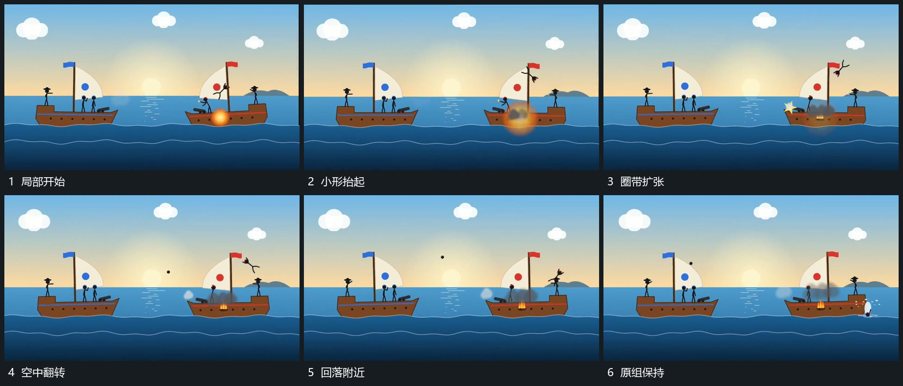

# 局部扩张圈带小形升起翻转后回落

## 运动指令

在承载形内部先出现局部小团并向外扩成圈带，同一位置的小形同时抬起。小形升高时改变角度，再向承载形附近回落；圈带先退弱，只留下少量局部起伏。其余组形与底线保持。

## 视频切片

[播放本机制的原片切片](m03.mp4)

覆盖分镜中“局部开始”至“原组保持”的连续过程，并保留邻近的前后衔接画面；原片中交叠发生的动作一并保留。

## 分镜过程

## 组合与调整

可改变回落方向；扩张和抬起在同一局部交叠，不能让整组突然远离。
