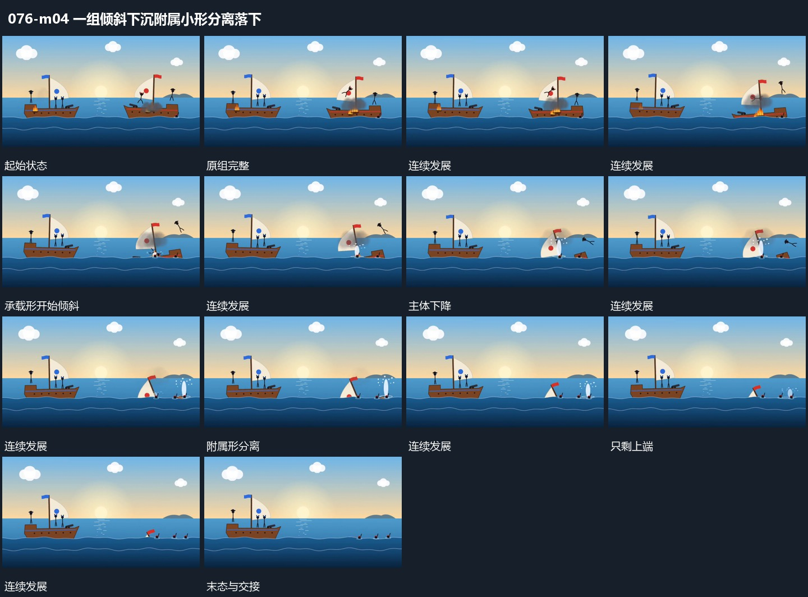

# 一组倾斜下沉附属小形分离落下

## 运动指令

让一组承载形先改变倾角，再逐步下降到下方曲线后。附属小形在主组下降中分离，带不同角度向下回落，落点附近短促展开细片。上端最后隐入曲线，只保留少量露出部分；另一组继续原有起伏。

## 视频切片

[播放本机制的原片切片](m04.mp4)

保留起始准备、连续发展和完成或明确交接；首尾按本段运动范围裁切，不拼接、不变速。尾部只保留理解结果所需的展示。

## 分镜过程

## 组合与调整

下沉应逐步经过共同底线，遮挡跟随高度变化；不要把整组同步淡出替代空间过程。
