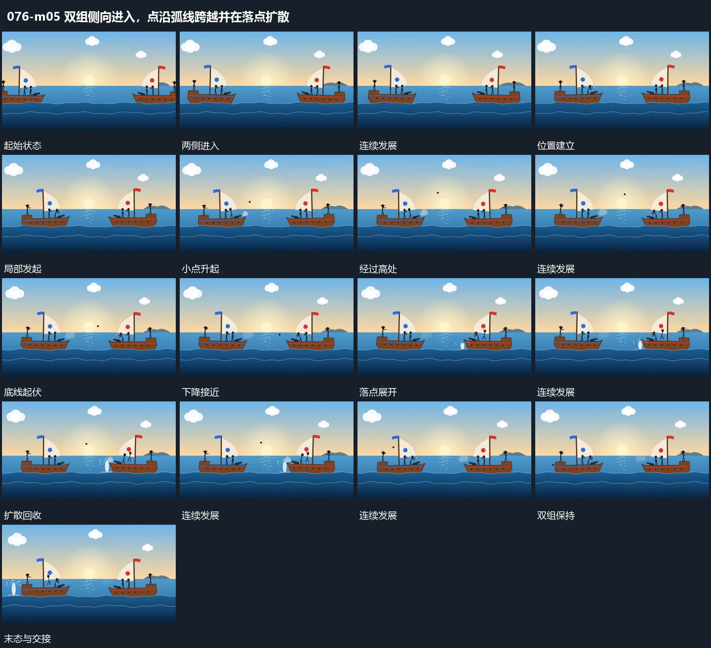

# 双组侧向进入，点沿弧线跨越并在落点扩散

## 运动指令

两组从两侧进入并随底线轻微起伏；小点从一侧沿弧线跨过间隔，在另一侧落点竖向扩散。

1. **双组从两侧进入并随底线小幅起伏**

让两组承载形从左右两侧相向进入，到各自位置后减小横向移动。下方曲线持续起伏，两组随曲线作小幅升降，组内附属形保持相对位置。两组之间留出稳定间距，供后续小点经过。

2. **小点沿弧线跨越间距落点竖向扩散**

在一侧局部发起小点，让它先上升、跨过中间空区再下降。接近另一侧下缘时，小点退去，落点附近竖向片和细点短促向外展开，再收回底线附近。反向使用时镜像路径，双组位置不变。

整段结束：两组分居左右且保持间距 保留必要落稳与交接，中间已建立的参照沿用到下一步骤。

## 视频切片

[播放本机制的原片切片](m05.mp4)

保留起始准备、连续发展和完成或明确交接；首尾按本段运动范围裁切，不拼接、不变速。相连的小动作合为同一完整段落。

## 分镜过程

## 组合与调整

两组从两侧进入并随底线轻微起伏；小点从一侧沿弧线跨过间隔，在另一侧落点竖向扩散。 复用时可调整元素数量、幅度和相对节奏，保留上述进入、交叠与完成关系；不直接沿用原片题材或时长。

可只保留一组，另一侧作为落点；两组的大幅入场结束后，底部起伏保持较小幅度。

路径与落点必须连续；改变弧线高度即可，不把扩散放在小点尚未到达的另一处。
