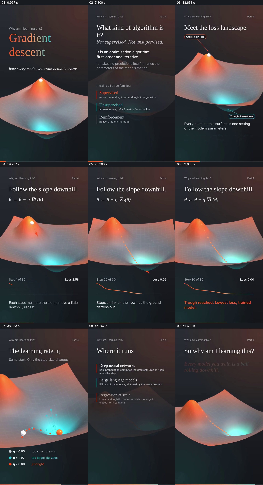

# 在同一损失地形上先走一条路径，再比较不同步长

- 作品：案例 097《梯度下降的地形比喻》（本次概括）。
- 原片范围：00:00.000–00:56.967，含起点、不含终点；[完整原片](../video.mp4)｜[本卡片段](../video.mp4)。
- 观察方式：依据约每秒一次的真实源帧观察，未连续原速观看或听审；声音、语气与完整播放节奏未确认。

## 原画面具体怎样设计

竖屏先显示渐变曲面与梯度下降标题，文字介绍优化算法；曲面上标注高损失与低损失，小球沿坡面逐步移动，下方同步更新步数、损失与曲线。随后同一地形上出现不同颜色的小球与学习率图例，轨迹表现小步、较大步和另一种选择的差异；末尾列出应用并回到曲面与总结文字。

## 为什么这样设计，好在哪里

同一地形提供稳定参照，球的位置、轨迹和损失曲线让每次迭代产生可见结果；并列不同步长使参数差异可以直接比较。画面是简化比喻，算法及适用条件需独立核查。

以上为依据画面的分析，非作者自述；预期观看效果未经观众测试。

## 可直接使用的创意指令

解释迭代优化时，选一个可计算的损失函数，先显示起点、坡度与每步更新，并同步呈现损失变化；再保持同一函数和起点比较不同步长的真实轨迹与结果，说明地形只是低维示意及其局限。
