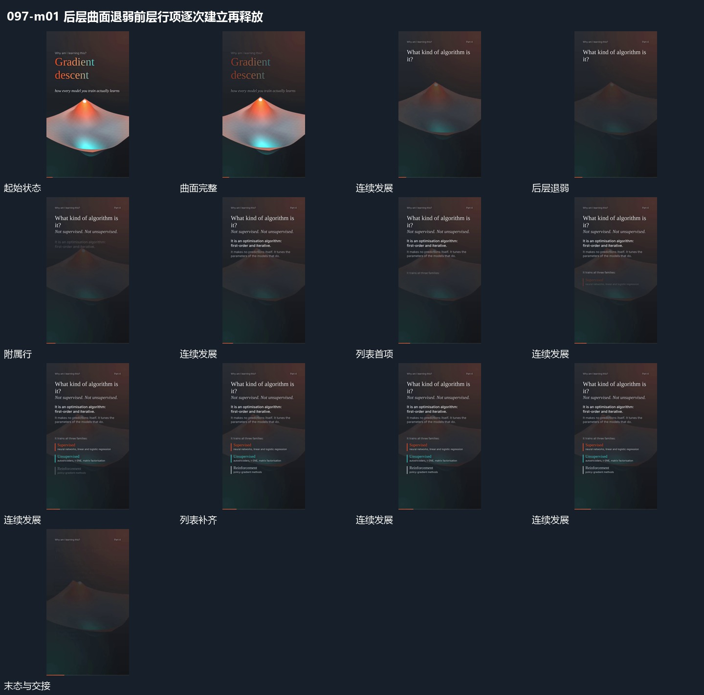

# 后层曲面退弱前层行项逐次建立再释放

## 运动指令

保持曲面位置但逐步减弱，前层先接主行，再在下方逐项补列表。已有项保持原位，曲面仍有少量转角变化。列表完成后整体退去，曲面重新增强并回到主要范围，保留同一局部参照。

## 视频切片

[播放本机制的原片切片](m01.mp4)

覆盖分镜中“曲面完整”至“前层退去”的连续过程，并保留邻近的前后衔接画面；原片中交叠发生的动作一并保留。

## 分镜过程

## 组合与调整

可用于图块列表；后层保持连续，前层不应每增一项就挤动曲面。
