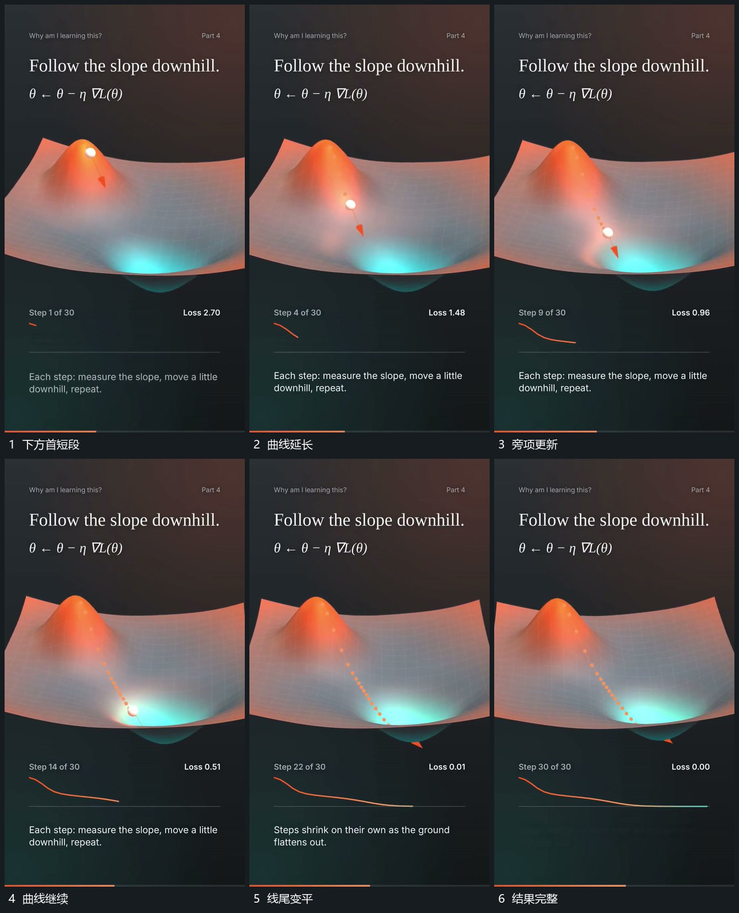

# 路径推进时下方曲线逐段延长旁项更新

## 运动指令

主路径继续推进，下方从首短段开始延长另一条曲线，曲线向前时逐步降低并收小起伏。旁侧短项在固定位置接替，已绘线保留；结束后线尾变平，主路径和下线共同保持。

## 视频切片

[播放本机制的原片切片](m04.mp4)

覆盖分镜中“下方首短段”至“结果完整”的连续过程，并保留邻近的前后衔接画面；原片中交叠发生的动作一并保留。

## 分镜过程

## 组合与调整

两区保持各自范围，旁项不跟线端漂移；无需声称下线由真实计算得到。
