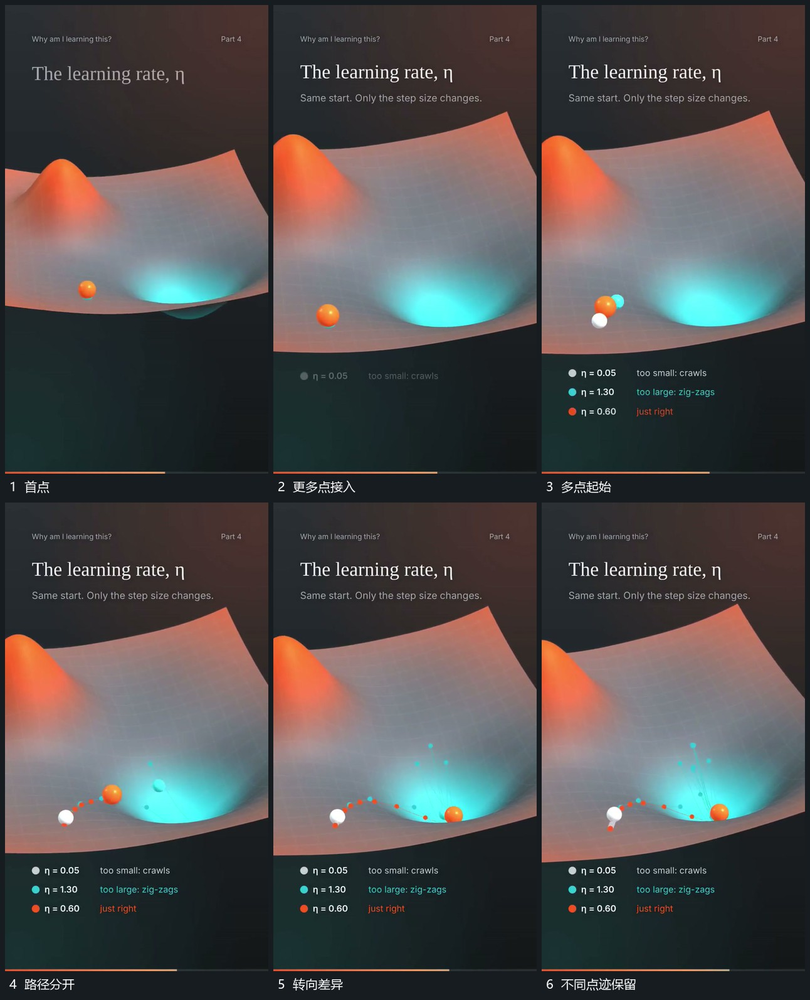

# 同一区域多点以不同步幅与转向经过

## 运动指令

在曲面同一区域建立多个点，错开开始移动。一个点以较小步幅连续经过，另一点跨更大范围并来回转向，第三点沿较短路线靠近低处。各点分别留下自己的点迹，曲面和外围短标保持。

## 视频切片

[播放本机制的原片切片](m05.mp4)

覆盖分镜中“首点”至“不同点迹保留”的连续过程，并保留邻近的前后衔接画面；原片中交叠发生的动作一并保留。

## 分镜过程

## 组合与调整

可以只保留两点；路径差异来自可见位移关系，不把原片解释内容写进机制。
