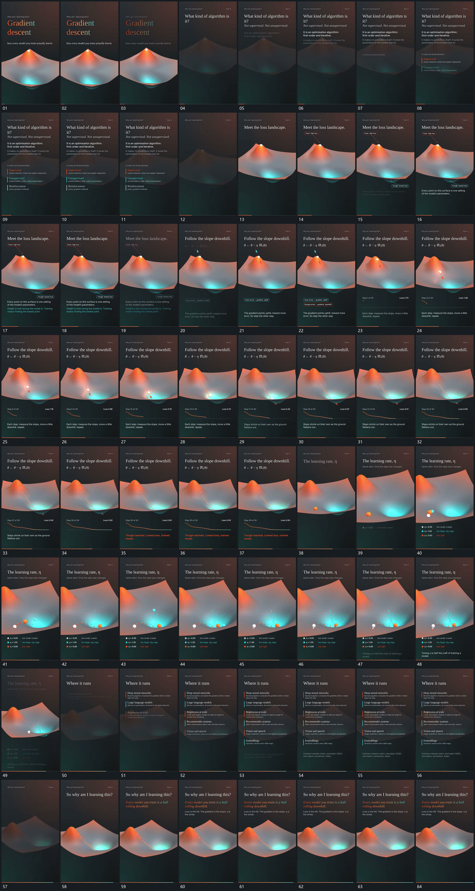

# 097｜原片运动总览

[观看完整原片](video.mp4)

## 运动总览

全片保留同一曲面作为运动参照。后层曲面退弱前层行项逐次建立再释放先减弱曲面并逐项建立上方行与列表，再释放前层，让曲面重新成为主要范围。从曲面局部延出短线并接上小标从曲面局部延出短线与小标，单点沿曲面下降留下点迹到低处逐步收小位移让单点沿曲面下降，留下连续点迹。

下降过程中路径推进时下方曲线逐段延长旁项更新在下方逐步延长曲线并更新旁侧短项。第二阶段同一区域多点以不同步幅与转向经过从同一区域发起多点，各点按不同步幅和转向经过，路径并行保留。结尾曲面退小并继续复用后层曲面退弱前层行项逐次建立再释放建立列表，再回到曲面与轨迹共同保持。

## 完整运动段落

以下按原片中的出现顺序引用。建立、内部发展及完成反馈放在同一段中；同时发生的局部动作与运镜写在同一份指令里。不同段之间可以是连续接管，也可以是直接切换，不能仅凭条目相邻认定可直接拼接。重复出现的同类运动采用一次连续代表范围，切片不以逐段无缝覆盖整片为目标。

1. [后层曲面退弱前层行项逐次建立再释放](mechanisms/m01.md)：后层退让前层累积

2. [从曲面局部延出短线并接上小标](mechanisms/m02.md)：点先保持线后延长

3. [单点沿曲面下降留下轨迹，下方曲线与旁项同步更新](mechanisms/m06.md)：单点沿曲面逐步下降，旧点位保留，到低处逐步减小位移；下方曲线随路径推进增长，旁项同步更新至落稳。

4. [同一区域多点以不同步幅与转向经过](mechanisms/m05.md)：错开位移不同路径并行

切片保留起始准备、必要内部停顿和完成或明确交接；首尾省略无新发展的等待，持续运动不要求人为停住。以上基于真实源帧序列和重点边界核对，不等同于全片连续声画审片。

## 完整64宫格

