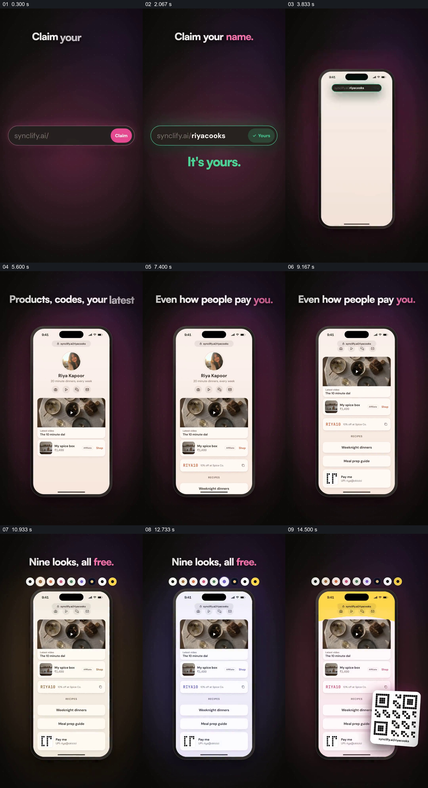

# 从地址领取开始，让一个个人页逐项长出来

- 作品：案例 049《照片主页与竖屏手机》（库内索引名）。
- 原片范围：00:00.000–00:16.000，含起点、不含终点；[完整原片](../video.mp4)｜[本卡片段](c01.mp4)，片段起点对应原片 0.000 秒。
- 范围依据：0–16 秒从地址设定到个人页组成、配色和二维码，完成一套页面创建及分享的表现；之后进入页面使用反馈。
- 观察方式：核看全片 64 帧总览及本卡九宫格；未独立连续原速观看，快速变化和运动节奏待核。未独立听审，声音内容未知。片中事实和演示未独立查证，新题材迁移尚未实测。

## 原画面具体怎样设计

深色带紫红光晕的竖画幅上方写 “Claim your name.”，下方长条中出现个人地址与粉色领取按钮；输入结束后长条边框变绿、出现 “Yours” 与 “It’s yours.”。同一地址随后出现在居中手机顶部，空白页面逐步增加头像、姓名、简介与社交图标。

手机保持在画面中央，页面中依次显示视频封面、商品条目、优惠码、食谱按钮和收款入口；随着内容增加，屏内显示区域上移，让下方新模块可见。顶部标题随重点从按钮转向商品、视频与付款。然后手机上方出现九个配色小圆点，同一页面在浅色、深色及鲜艳配色之间变化；最后一张二维码卡出现在手机右前方，二维码下方写着相同的个人地址。地址、价格、付款功能及二维码均是片中演示，未验证是否可用。

## 为什么这样设计，好在哪里

地址从独立输入条进入手机顶部，成为整页的身份锚点；模块在同一屏中逐次出现，观众能看到页面由空到有，而不是面对一张信息密集的完成截图。配色比较时页面内容基本不变，差异集中在外观；二维码放在手机旁并保留相同地址，使分享入口与刚建立的页面发生关系。若只切换互不相关的个人页，地址、内容、外观和分享的连续性就会消失。这里是对画面的分析，未验证产品能力或实际观看效果。

## 完整照排指令

以[完整原片](../video.mp4)的 0–16 秒为准。画幅 720×1280，源帧率 30/1。以下拍点为抽帧定位，位置按画幅百分比取近似值。

### 用料

【个人地址】【个人头像】【个人名称】【首屏图片】【商品条目】【内容模块组】【主题版本组】【分享二维码】都指向同一个人和同一页面。主题版保持相同位置和顺序，二维码须实扫码核对。备【阶段标题组】【领取状态】【访问读数】【互动读数】【趋势小图】，真实读数附可打开的报表和日期。

### 按源时刻摆放

1. **0–约 3.500 秒。** 竖幅黑褐紫底，中上白粗【阶段标题组】，末词粉色。中部一条深底细粉边输入槽，逐字写【个人地址】，右端粉色胶囊。提交后描边和按钮转绿，并于槽下亮绿显示【领取状态】。保留该地址，不循环领取。
2. **约 3.500–9 秒。** 白色圆角手机从中下建立，输入槽短跨手机上部再退。手机内先出现顶端【个人头像】【个人名称】，再沿底部依次增加【首屏图片】【商品条目】【内容模块组】。外部标题逐次说不同模块，白字与粉色重点留在上方。手机从首屏到模块完成保持同框。静态截图可分层递增，实际录屏按同一操作顺序连续播放。
3. **约 9–14 秒。** 手机仍正对观众，上方换浅色大字和一排彩色选择圆点。按【主题版本组】依次显示多种颜色和深浅，图片、模块、个人名称原位保留。主题切换完成后，选色点退暗，手机右下斜叠白卡【分享二维码】，让码盖一点边框但不遮主图。持续到统计接管。
4. **约 14–16 秒。** 手机稍移左，右侧进入暗色统计区，白粗【访问读数】和粉色【互动读数】，配较弱【趋势小图】和行表。使用可回查的终值，依旧是同一页，按 16 秒切出。

### 局部采用

只有同页模块可取约 3.500–9 秒。只有同构主题和真码可采用约 9–14 秒。统计与页面不能回查时在二维码态结束。

### 验证状态

已对照每秒两帧原片画序并读回，核对地址入框、手机模块累积、主题变化保留布局、二维码及统计叠位。精确切帧、读数口径及换料待核。
