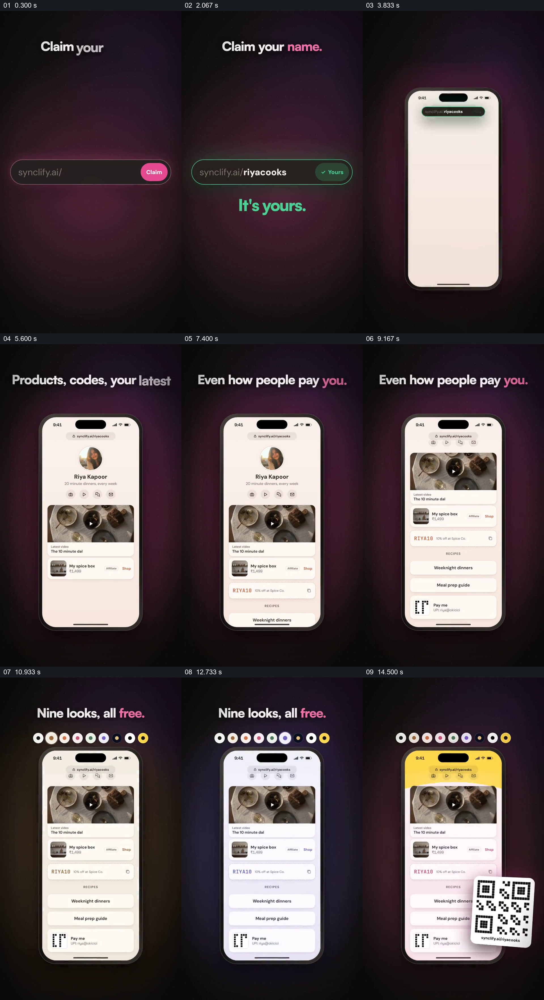

# 从领取名称到填充个人页并选择外观

- 作品：案例 049《个人链接页面与访问统计》（索引名称）。
- 原片范围：00:00.000–00:16.000，含起点、不含终点；[完整原片](../video.mp4)｜[本卡片段](c01.mp4)。
- 观察方式：依据整片 64 宫格和约每秒一次的真实源帧观察，未连续原速观看或听审；声音、语气与完整播放节奏未确认。

## 原画面具体怎样设计

深色竖屏输入个人地址并显示可用；手机里的头像页面逐渐加入图片、产品条目及付款入口。顶部一排颜色按钮对应页面的多种外观，最后二维码叠在手机旁。

## 为什么这样设计，好在哪里

同一页面逐渐填充，能将地址、内容和分享入口联系起来；固定页面比较外观，减少对象变化带来的干扰。页面功能及付款能力为示意。

以上为依据画面的分析，非作者自述；预期观看效果未经观众测试。

## 可直接使用的创意指令

展示个人页面时，以真实或标注模拟的身份和内容建立地址，再逐项展示可发布的资料、链接及分享方式；以同一内容比较实际支持的样式，付款功能和权限须核实。
