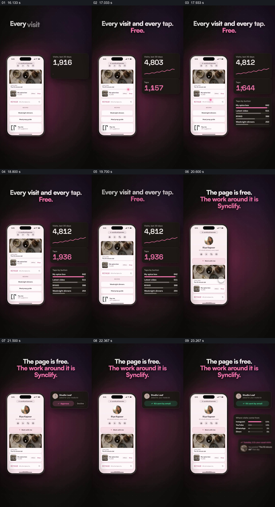

# 保留个人页作为参照，让统计与后续工作浮在旁边

- 作品：案例 049《照片主页与竖屏手机》（库内索引名）。
- 原片范围：00:16.000–00:24.000，含起点、不含终点；[完整原片](../video.mp4)｜[本卡片段](c02.mp4)，片段起点对应原片 16.000 秒。
- 范围依据：16–24 秒中同一页面持续作为参照，旁侧由访问点击统计转为合作请求及来源反馈，属于页面后续工作的连续展示；之后进入创建步骤和品牌结尾。
- 观察方式：核看全片 64 帧总览及本卡九宫格；未独立连续原速观看，快速变化和运动节奏待核。未独立听审，声音内容未知。片中事实和演示未独立查证，新题材迁移尚未实测。

## 原画面具体怎样设计

深色背景中的个人页缩到左侧，页面内容仍可辨认；右侧先出现黑色访问卡，标记 “Visits, last 30 days”，数值增加并出现粉色折线。下面接入点击总数，再补一张按按钮列出条目和横条的卡，内容包含商品、视频、优惠码和食谱等此前已在手机里出现的项目。

之后标题变为 “The page is free. The work around it is Synclify.”；手机页面仍在左边，右侧换成一张合作方请求媒体资料的卡，有批准和拒绝状态，随后显示资料已通过邮件发送，再补充访问来源比例卡。画面中的统计、请求、发送及收费主张只是演示，并未核实。

## 为什么这样设计，好在哪里

保持页面本身可见，使右侧统计有明确对象；分开的访问、点击和按按钮的条目让观众能把总体规模和具体入口区分开。统计列表里的名字来自左侧页面内容，因而不是悬空的数据装饰。接下来页面仍不离场，旁卡从量化结果切到一项后续工作及处理状态，让“页面发布之后”有多个具体后果。若删掉页面与对应条目，数字便很难知道在衡量什么；若把演示反馈说成真实业务记录则会越过画面证据。以上为设计分析，未做受众测试。

## 可直接使用的创意指令

要说明一个页面或作品发布后的反馈时，保留可辨的原页面作为参照，在旁边分层呈现经过核对的总体访问、具体操作与对应条目；每张卡标明统计时间和单位。若后续还有实际请求、审核或发送过程，可在同一旁侧区域以连续状态展示，让它与该页面保持身份对应。页面样式、指标和卡片排列可按内容调整；数据须有来源及口径，模拟请求或自动发送状态不得写成已经发生。
