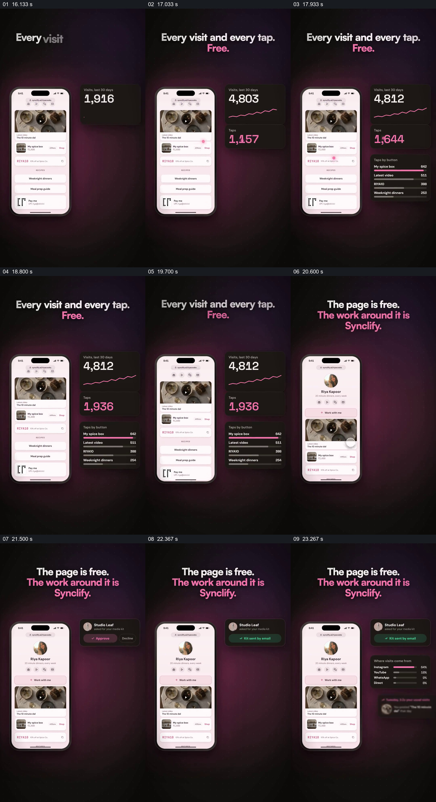

# 保留个人页作为参照，让统计与后续工作浮在旁边

- 作品：案例 049《照片主页与竖屏手机》（库内索引名）。
- 原片范围：00:16.000–00:24.000，含起点、不含终点；[完整原片](../video.mp4)｜[本卡片段](c02.mp4)，片段起点对应原片 16.000 秒。
- 范围依据：16–24 秒中同一页面持续作为参照，旁侧由访问点击统计转为合作请求及来源反馈，属于页面后续工作的连续展示；之后进入创建步骤和品牌结尾。
- 观察方式：核看全片 64 帧总览及本卡九宫格；未独立连续原速观看，快速变化和运动节奏待核。未独立听审，声音内容未知。片中事实和演示未独立查证，新题材迁移尚未实测。

## 原画面具体怎样设计

深色背景中的个人页缩到左侧，页面内容仍可辨认；右侧先出现黑色访问卡，标记 “Visits, last 30 days”，数值增加并出现粉色折线。下面接入点击总数，再补一张按按钮列出条目和横条的卡，内容包含商品、视频、优惠码和食谱等此前已在手机里出现的项目。

之后标题变为 “The page is free. The work around it is Synclify.”；手机页面仍在左边，右侧换成一张合作方请求媒体资料的卡，有批准和拒绝状态，随后显示资料已通过邮件发送，再补充访问来源比例卡。画面中的统计、请求、发送及收费主张只是演示，并未核实。

## 为什么这样设计，好在哪里

保持页面本身可见，使右侧统计有明确对象；分开的访问、点击和按按钮的条目让观众能把总体规模和具体入口区分开。统计列表里的名字来自左侧页面内容，因而不是悬空的数据装饰。接下来页面仍不离场，旁卡从量化结果切到一项后续工作及处理状态，让“页面发布之后”有多个具体后果。若删掉页面与对应条目，数字便很难知道在衡量什么；若把演示反馈说成真实业务记录则会越过画面证据。以上为设计分析，未做受众测试。

## 完整照排指令

以[完整原片](../video.mp4)的 16–24 秒为准。画幅 720×1280，源帧率 30/1。以下拍点为抽帧定位，位置按画幅百分比取近似值。

### 用料

【个人主页】【访问读数】【互动读数】【趋势小图】沿用前卡同名内容，统计须属于该页面和同一周期。备【来源列表】【合作请求】【合作状态】【访问标题】【工作标题】【下一段步骤】。实际数据和合作记录附可打开的来源或授权存档。

### 按源时刻摆放

1. **16–约 19.500 秒。** 暗黑褐底带柔粉光晕。上方黑底反白粗【访问标题】，粉词补成第二行。左半固定竖手机【个人主页】，白页中保留同一主图。右半先出白粗【访问读数】和细粉【趋势小图】，随后加粉色【互动读数】及按行缩小的【来源列表】。数字达到终值后仍同场共读，不随每行更新而退出。
2. **约 19.500–21.000 秒。** 顶部原位更新【工作标题】，第二行粉色。统计层渐退，左侧同一手机继续展示，同一页适当上滚露出身份头像，不换账号。
3. **约 21.000–23.200 秒。** 右侧上部立小暗卡【合作请求】，头像与请求文字同组，短状态从暗粉转亮绿【合作状态】。下方再累积数行【来源列表】与小请求项。手机一直留到组合让位。界面可用同源静图做换态；实录从同次统计到对应页，不循环确认状态。
4. **约 23.200–24.000 秒。** 双栏退，暗底中轴逐条建立横【下一段步骤】，数字粉色、标题白色。按 24 秒截出；若只用统计与合作，在首个步骤之前切。

### 局部采用

可从 16–约 19.500 秒单取同页统计，或用约 19.500–23.200 秒表现工作流。后者仍需同一主页作为参照。

### 验证状态

已对照每秒两帧画序并读回，核对左机持续、右数和列表累积、合作状态替换及步骤切出。精确切帧、字段原字及换料待核。
