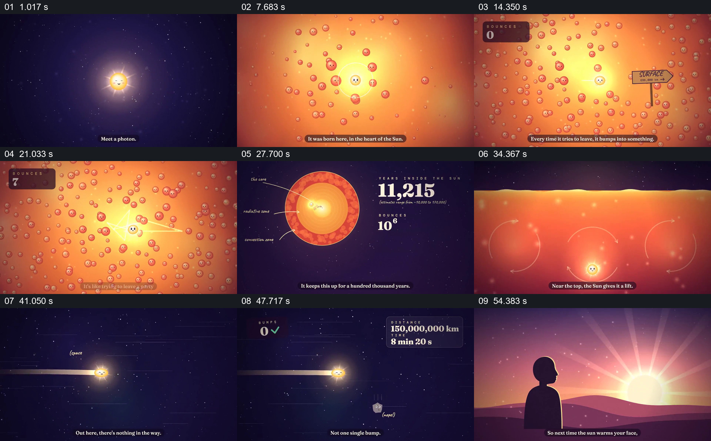

# 跟随一个光子，用碰撞计数对照太阳内外的旅程

- 作品：案例 071《光子离开太阳的漫长旅程》（本次概括）。
- 原片范围：00:00.000–01:00.053，含起点、不含终点；[完整原片](../video.mp4)｜[本卡片段](../video.mp4)。
- 观察方式：依据约每秒一次的真实源帧观察，未连续原速观看或听审；声音、语气与完整播放节奏未确认。

## 原画面具体怎样设计

星空中一个小光点被标为光子，带着小箱子出发；太阳内部变成拥挤的橙色粒子空间，温度计建立环境，光子朝出口移动却反复碰撞，计数器上升。画面切成太阳剖面，光子位置、累计年数和碰撞数量并列，下面出现人类历史的图像作为时间参照；接着光子上升穿出表面，在星空中以直线飞行，距离和时间计数出现，途经行星后抵达地球、进入一只眼睛，最后落到人物面对日出的画面。

## 为什么这样设计，好在哪里

一个带表情的光子持续贯穿大尺度切换，拥挤碰撞与外部直线飞行形成可见对照；计数器和历史参照使作品所声称的漫长时间有比较对象，眼睛与日出又把遥远过程接回日常感受。科学数字和简化模型需要另行核对。

以上为依据画面的分析，非作者自述；预期观看效果未经观众测试。

## 可直接使用的创意指令

解释同一对象跨越不同环境的过程时，选择可持续识别的主体，先在第一环境中展示使进程变慢或改变方向的具体交互，再用有来源的计数和熟悉参照表达尺度；切换环境后保留主体并明确新的路径、时间或距离，最后让它抵达与观众有关的结果。科学细节、尺度及简化程度应由可靠材料确定。
