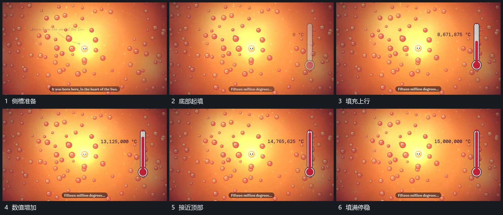

# 侧槽由下向上填满，数字随填充推进

## 运动指令

在中心组旁建立竖向槽，让内部填充从底部向上增加，旁边数值随过程不断增长。槽边界保持不动，中心组仍留场；填充接近顶部后数值趋于停止，留下完整结果。

## 视频切片

[播放本机制的原片切片](m03.mp4)

覆盖分镜中“侧槽准备”至“填满停稳”的连续过程，并保留邻近的前后衔接画面；原片中交叠发生的动作一并保留。

## 分镜过程

## 组合与调整

可改槽的方向和长宽，保持起点固定与可见终点。若迁移到真实比例展示，需另核数值和填充高度的对应，不能从原片示意直接取得比例。
