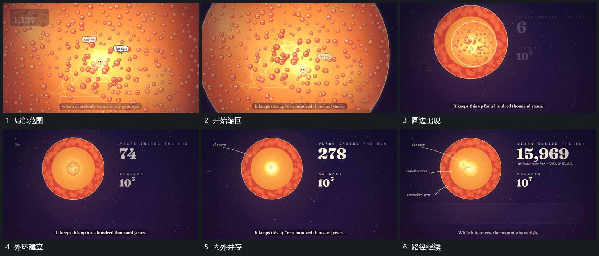

# 局部整体缩进圆区，外环显出而内部动作继续

## 运动指令

将正在活动的局部整体缩小，使它落入中央圆形内区，外侧多层环逐渐进入视野。内部路径继续增长，外环保持稳定，旁侧数字随之建立并继续增加；由此把刚才占满画面的过程放进更大的范围。

## 视频切片

[播放本机制的原片切片](m05.mp4)

覆盖分镜中“局部范围”至“路径继续”的连续过程，并保留邻近的前后衔接画面；原片中交叠发生的动作一并保留。

## 分镜过程

## 组合与调整

可改外层范围和缩回幅度，保持内部动作的接续，不在缩小中途切成无动作静图。后续可在外层补参照组，或再向内推近。
