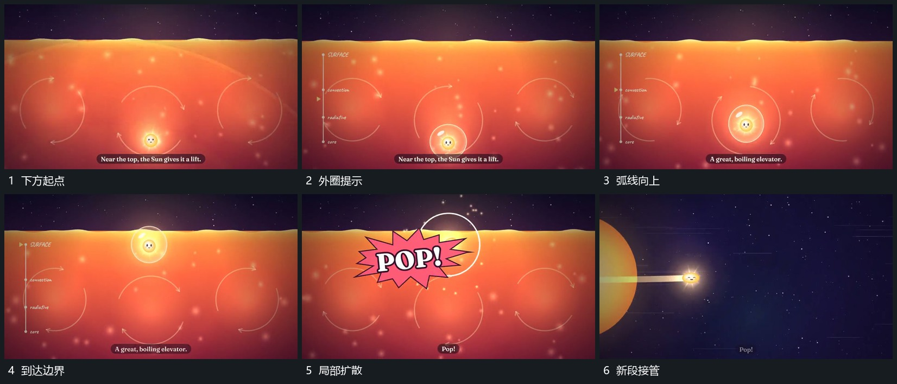

# 小圆沿弧线越过边界，扩散与亮闪接管换场

## 运动指令

在新的横向分层里，让下方小圆先出现外环提示，周边箭头形成环流。随后小圆沿弯曲路径向上靠近边界；抵达时出现爆裂形与向外扩散的圈，接着亮闪覆盖，再进入下一横向画面。

## 视频切片

[播放本机制的原片切片](m07.mp4)

覆盖分镜中“下方起点”至“新段接管”的连续过程，并保留邻近的前后衔接画面；原片中交叠发生的动作一并保留。

## 分镜过程

## 组合与调整

可改变边界倾角和路径弯度，保留到达再触发的因果顺序。前面的圆区到横向分层是换景接续，不将它冒写成同一圆环真实展开。
