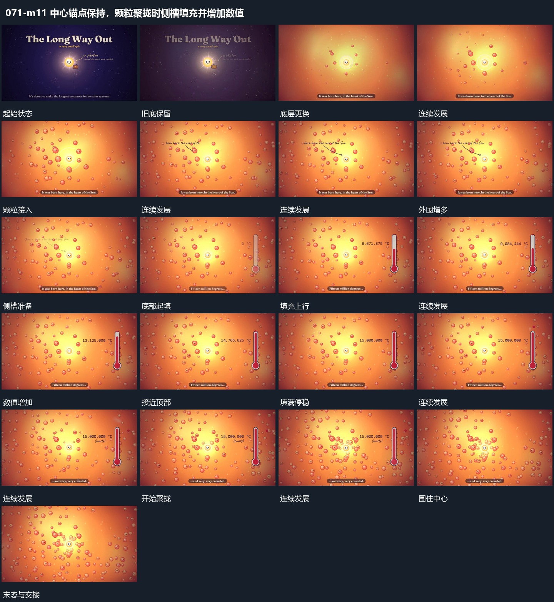

# 中心锚点保持，颗粒聚拢时侧槽填充并增加数值

## 运动指令

换入近处颗粒层时中心位置保持，颗粒向内聚拢；侧槽自下而上填满，数字与填充同步完成。

1. **中心锚点保留，后层更换后颗粒向其聚拢**

保持中心圆形的位置，让后层叠化为新的范围，周围小粒由少到多接入。旁侧引线文字建立后，小粒逐步向中心靠近，形成更紧的分布，但不给中心本身造成完全遮挡；中心继续作为后续运动的起点。

2. **侧槽由下向上填满，数字随填充推进**

在中心组旁建立竖向槽，让内部填充从底部向上增加，旁边数值随过程不断增长。槽边界保持不动，中心组仍留场；填充接近顶部后数值趋于停止，留下完整结果。

整段结束：新底层接管，更多小粒围绕中心分布并向其聚拢。 保留必要落稳与交接，中间已建立的参照沿用到下一步骤。

## 视频切片

[播放本机制的原片切片](m11.mp4)

保留起始准备、连续发展和完成或明确交接；首尾按本段运动范围裁切，不拼接、不变速。相连的小动作合为同一完整段落。

## 分镜过程

## 组合与调整

换入近处颗粒层时中心位置保持，颗粒向内聚拢；侧槽自下而上填满，数字与填充同步完成。 复用时可调整元素数量、幅度和相对节奏，保留上述进入、交叠与完成关系；不直接沿用原片题材或时长。

后层更换与聚拢之间有标注阶段，不要求全部同时发生。可改变小粒数量与密度，保留中心活动通道；不能把聚拢解释成未经核实的真实物理作用。

可改槽的方向和长宽，保持起点固定与可见终点。若迁移到真实比例展示，需另核数值和填充高度的对应，不能从原片示意直接取得比例。
