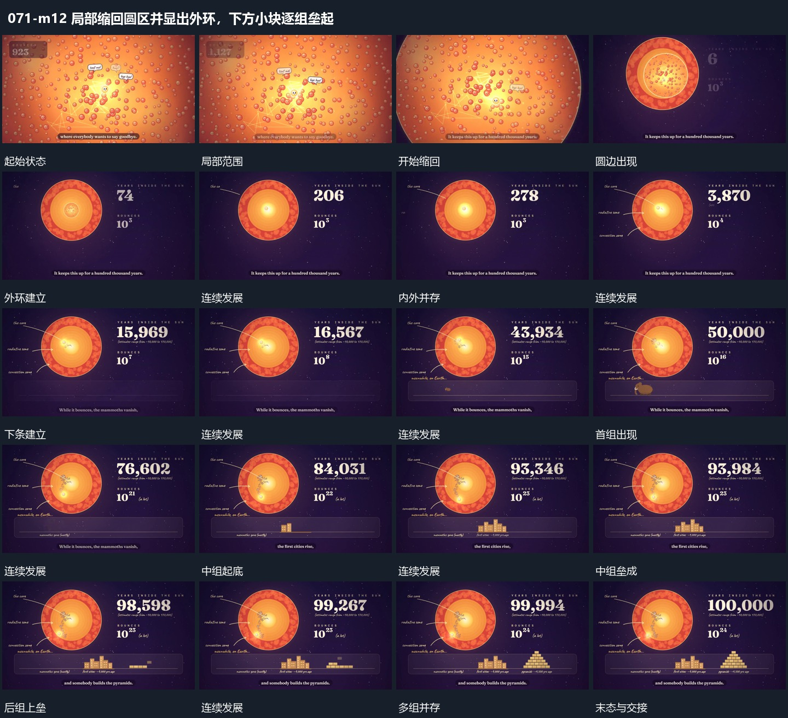

# 局部缩回圆区并显出外环，下方小块逐组垒起

## 运动指令

局部整体缩小收进圆形区域，外环和旁侧数值接入，内部活动持续；下方小块从低到高逐组叠起，已完成者保持。

1. **局部整体缩进圆区，外环显出而内部动作继续**

将正在活动的局部整体缩小，使它落入中央圆形内区，外侧多层环逐渐进入视野。内部路径继续增长，外环保持稳定，旁侧数字随之建立并继续增加；由此把刚才占满画面的过程放进更大的范围。

2. **下方小块由低到高逐组垒起，前组保留**

在上方过程持续的同时建立下方长条，先在一端出现小形，再在中间把多个块从下向上垒成一组。随后另一端的块也从底层向上增加，形成更高的组；前面各组保留，底边提供共同参照。

整段结束：下方不同位置形成由小到大的多组堆叠。 保留必要落稳与交接，中间已建立的参照沿用到下一步骤。

## 视频切片

[播放本机制的原片切片](m12.mp4)

保留起始准备、连续发展和完成或明确交接；首尾按本段运动范围裁切，不拼接、不变速。相连的小动作合为同一完整段落。

## 分镜过程

## 组合与调整

局部整体缩小收进圆形区域，外环和旁侧数值接入，内部活动持续；下方小块从低到高逐组叠起，已完成者保持。 复用时可调整元素数量、幅度和相对节奏，保留上述进入、交叠与完成关系；不直接沿用原片题材或时长。

可改外层范围和缩回幅度，保持内部动作的接续，不在缩小中途切成无动作静图。后续可在外层补参照组，或再向内推近。

可改组数与堆叠层数，保持逐组展开和共同底边。若用于数值比较须另给准确映射，不把此运动关系当成数据证据。
