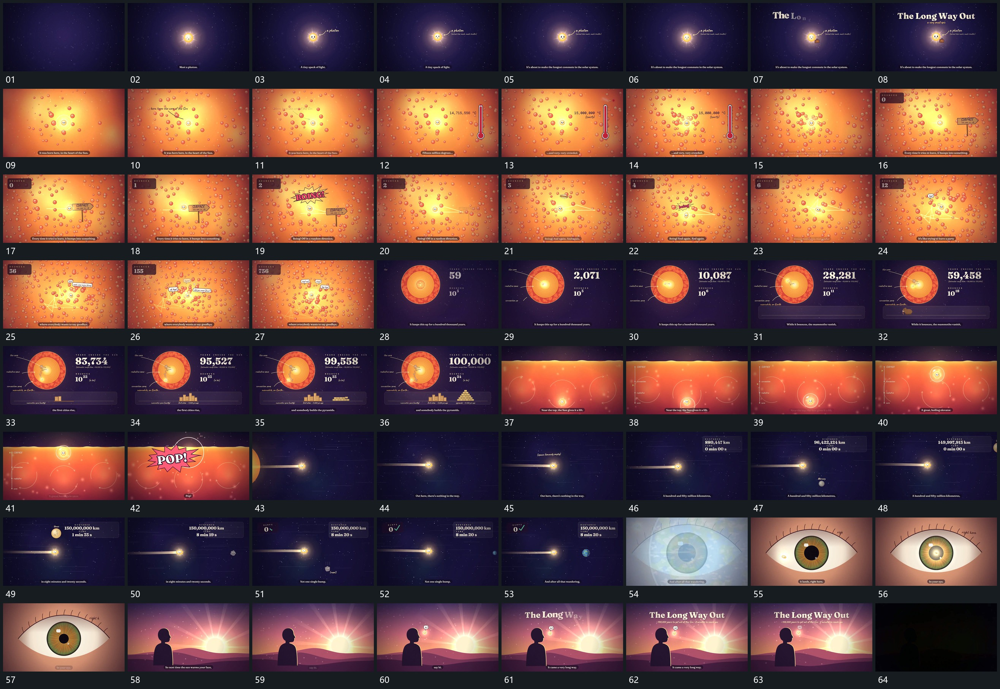

# 071｜原片运动总览

[观看完整原片](video.mp4)

## 运动总览

先用 中心圆形放大落稳，引线与文字接续建立 建立中心小圆、引线和文字。中心锚点保留，后层更换后颗粒向其聚拢 保留中心、更换后层并增加周边颗粒；旁侧 侧槽由下向上填满，数字随填充推进 从底部填满竖槽并累计数字，之后周边继续聚拢，计数牌与指示形补入。

中段 小圆改向行进，旧轨迹保留形成连续折线 让小圆行进并反复改向，旧路径保留，后段转向与计数加快。随后 局部整体缩进圆区，外环显出而内部动作继续 将这段活动缩进中央圆区，露出外环，内部路径仍继续。外层稳定时，下方 下方小块由低到高逐组垒起，前组保留 逐组垒起不同高度的小块，数值继续增长后收停。

旧标注退去，圆区推近；随后换入新的横向分层，并未把这次换景认定为同一形体的几何展开。小圆沿弧线越过边界，扩散与亮闪接管换场 从下方向上走弧线，到边界触发扩散和亮闪，再接 主形位置近乎固定，周边反向经过形成跟随感 的跟随感：主圆位置近乎固定，尾迹与周边反向移动。

后方小形离开，主路线仍持续；前方圆形靠近后，由 前方圆形靠近放大，同形叠化后亮点沿弧线汇入 同形叠化进入局部，小亮点沿弧线缩入中心。留下的静止结构再用 上下合拢遮住旧层，新层从中缝向两侧展开 合拢遮住，新场从中缝展开。尾段小圆在新的前景附近建立，文字沿用逐字显现，最后整体减淡。

## 完整运动段落

以下按原片中的出现顺序引用。建立、内部发展及完成反馈放在同一段中；同时发生的局部动作与运镜写在同一份指令里。不同段之间可以是连续接管，也可以是直接切换，不能仅凭条目相邻认定可直接拼接。重复出现的同类运动采用一次连续代表范围，切片不以逐段无缝覆盖整片为目标。

1. [中心圆形放大落稳，引线与文字接续建立](mechanisms/m01.md)：先稳定中心锚点，再向外围补线与文字，中心不随标注移动。

2. [中心锚点保持，颗粒聚拢时侧槽填充并增加数值](mechanisms/m11.md)：换入近处颗粒层时中心位置保持，颗粒向内聚拢；侧槽自下而上填满，数字与填充同步完成。

3. [小圆改向行进，旧轨迹保留形成连续折线](mechanisms/m04.md)：新线段从上一段末端继续生长，转向不清除已经走过的线。

4. [局部缩回圆区并显出外环，下方小块逐组垒起](mechanisms/m12.md)：局部整体缩小收进圆形区域，外环和旁侧数值接入，内部活动持续；下方小块从低到高逐组叠起，已完成者保持。

5. [小圆沿弧线越过边界，扩散与亮闪接管换场](mechanisms/m07.md)：运动体先到边界，反馈从接触处展开，再借覆盖换底。

6. [主形位置近乎固定，周边反向经过形成跟随感](mechanisms/m08.md)：主形保持观看位置，尾迹和背景反向移动提供持续前行感。

7. [前方圆形靠近放大，同形叠化后亮点沿弧线汇入](mechanisms/m09.md)：以圆形占位相似性接续换景，再把运动方向收向新中心。

8. [上下合拢遮住旧层，新层从中缝向两侧展开](mechanisms/m10.md)：闭合先完成遮蔽，短暂遮住后换底，新层再以相反方向展开。

切片保留起始准备、必要内部停顿和完成或明确交接；首尾省略无新发展的等待，持续运动不要求人为停住。以上基于真实源帧序列和重点边界核对，不等同于全片连续声画审片。

## 完整64宫格

