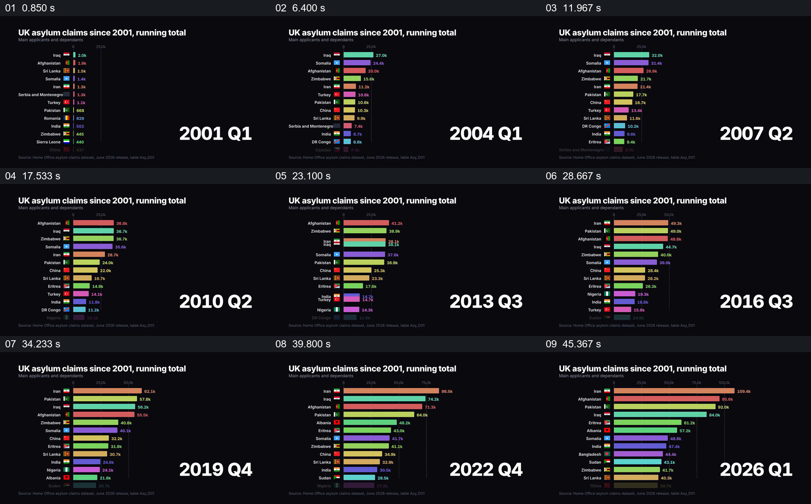

# 保持条形排行，随季度推进显示累计数量的变化

- 作品：案例 056《按季度变化的庇护申请排行》（索引名称）。
- 原片范围：00:00.000–00:50.090，含起点、不含终点；[完整原片](../video.mp4)｜[本卡片段](../video.mp4)。
- 观察方式：依据整片 64 宫格和约每秒一次的真实源帧观察，未连续原速观看或听审；声音、语气与完整播放节奏未确认。

## 原画面具体怎样设计

黑底左上标题为英国庇护申请累计总数，左侧多条彩色横条标有国家及数字；条长和排序随季度变化，右侧大字从 2001 年第一季度推进至 2026 年第二季度，最后停留在末期排行。

## 为什么这样设计，好在哪里

固定类别标签和时间位置，使观众可以追踪某一条目如何变化并与其他条目比较。底部来源文字与实际数据未独立核对，排行不解释变化原因。

以上为依据画面的分析，非作者自述；预期观看效果未经观众测试。

## 可直接使用的创意指令

展示长期累计排行时，采用统一来源与统计口径，持续标出当前日期、单位及类别；让条形和排序按真实数据变化，并为起止状态留出阅读时间。敏感人口统计应提供上下文，不能从排行推断个人行为。
