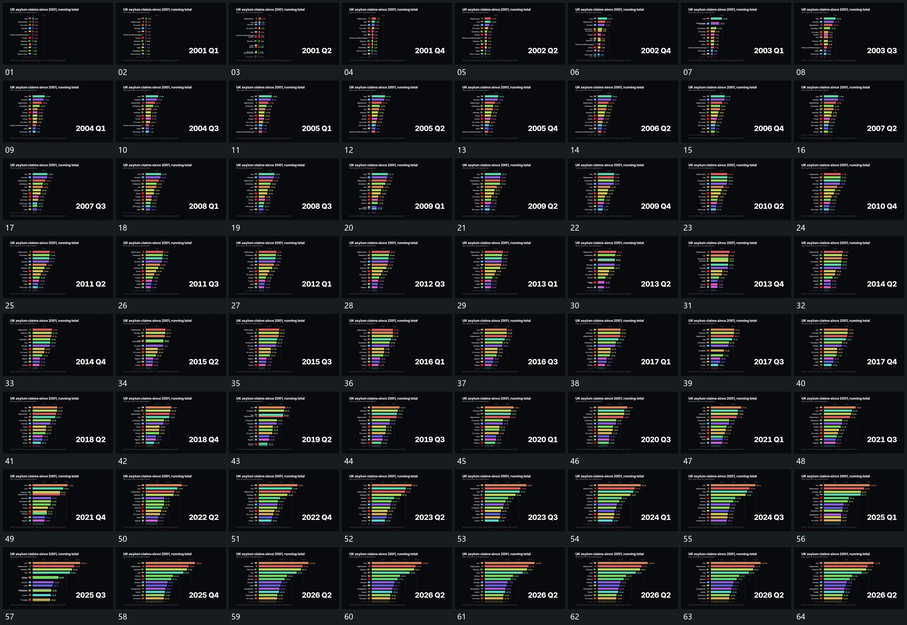

# 056｜原片运动总览

[观看完整原片](video.mp4)

## 运动总览

全片持续使用 横条持续增长，整行随次序交换位置，末端数值跟随：横条沿共同左边界伸长，末端数值不断更新，增长后的相对次序变化时整行交换位置，短标记与数值随同一条一起移动。旁侧阶段字在原位接替，顶部与底部说明保持。最后横条和阶段字停在结果状态，不为每次交换位置另建重复机制。

## 完整运动段落

以下按原片中的出现顺序引用。建立、内部发展及完成反馈放在同一段中；同时发生的局部动作与运镜写在同一份指令里。不同段之间可以是连续接管，也可以是直接切换，不能仅凭条目相邻认定可直接拼接。重复出现的同类运动采用一次连续代表范围，切片不以逐段无缝覆盖整片为目标。

1. [横条持续增长，整行随次序交换位置，末端数值跟随](mechanisms/m01.md)：长度变化与纵向重排联动

切片保留起始准备、必要内部停顿和完成或明确交接；首尾省略无新发展的等待，持续运动不要求人为停住。以上基于真实源帧序列和重点边界核对，不等同于全片连续声画审片。

## 完整64宫格

