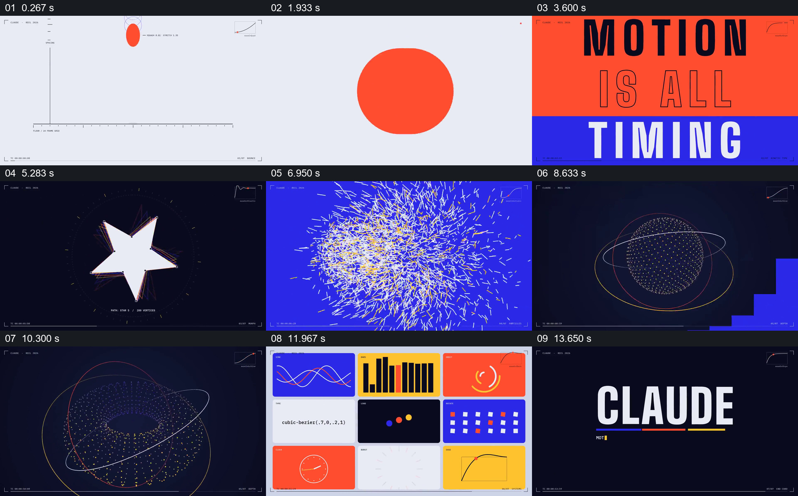
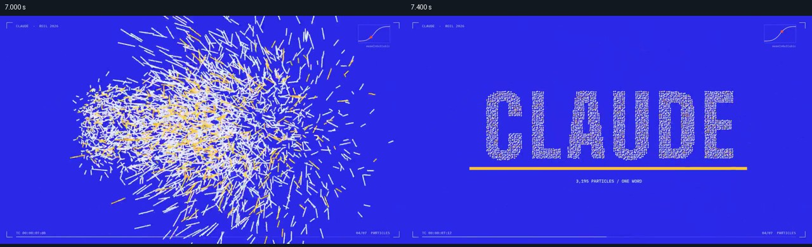

# 从时间示意进入各类作品，最后并列一组实验

- 作品：案例 115。
- 原片范围：00:00.000–00:15.061（源时间，含起点、不含终点）；[完整原片](../video.mp4)｜[本卡片段](../video.mp4)。复用完整原片和同范围分镜。
- 观察方式与未确认范围：核看全片 64 帧总览和本卡九宫格；未独立连续原速观看或听审，抽帧间运动、精确节奏、声音和同步未确认。价值判断为作品分析，跨项目迁移尚未实测。

补充源时间：7.000、7.400 秒。

## 原画面具体怎样设计

浅灰色坐标界面中，橙红点与若干空心圆处在同一垂直方向，下方是带刻度的横线，右上有小型曲线。之后橙红和蓝色块接管画面，分行排出“MOTION IS ALL TIMING”，让时序主题成为大字。

画面转入深色空间，白色方形、三角和星形依次出现在中央，外面有彩色轮廓；接下来蓝底上密集粒子聚成文字“CLAUDE”。随后暗底出现由点构成的球体，几条不同颜色的椭圆线环绕它。抽帧能确认形态顺序，不能证明每个形状都是同一对象无缝变形。

末段浅底上九个彩色小格同时出现，分别展示曲线、柱形、圆点、旋转网格、钟面等实验；这些格子展示的是另一组小实验，抽帧不足以确认它们是前面画面的缩小版本。最后深色背景保留名称和三色横线。

## 为什么这样设计，好在哪里

开头坐标与后续大字先提出“看什么”，中途让不同材料分别成为视觉中心，最后九格让观众同时看到另一组不同的图形示例。橙、蓝、黄和细小页边标签贯穿不同画面，使各段有共同身份；九格各自独立，观众能比较形式差异。

这是对展示逻辑的分析，图中曲线和“timing”并不证明实际动作符合某条曲线。

## 可直接使用的创意指令

当有一组可独立辨认的小作品时，先用一个简明画面或一句话提出共同主题，再让其中几项轮流获得完整画面；每项保留足以认出自身的主体和状态。之后并列一组互不遮挡的相关实验，形成从单项观看到多项比较的结果；也可在有对应关系时把已展示作品缩入网格，最后以创作者或主题身份收束。

网格数量、配色、素材和顺序可以改变；关键是每个示例可辨，并且网格与前面的共同主题有关。需要阅读时应缩减同屏数量并留足时间。
