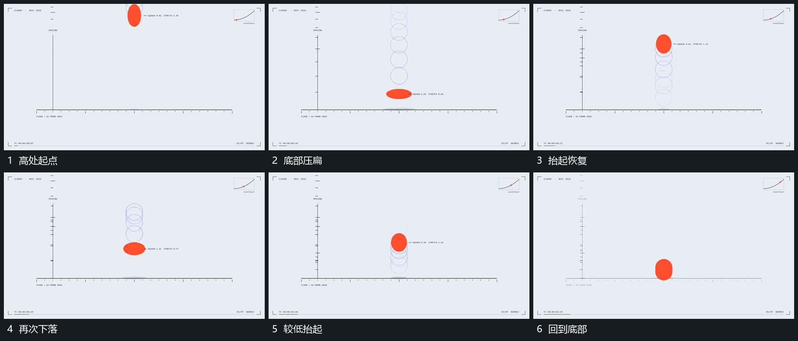

# 球垂向起落压扁后恢复并逐次降低高度

## 运动指令

球沿同一垂向范围下降，落到底部时压低并向两侧展开，抬起时收窄恢复。后续起落高度逐步降低，浅轮廓保留前一位置的短暂痕迹，最后收回较圆形态并落定。

## 视频切片

[播放本机制的原片切片](m01.mp4)

覆盖分镜中“高处起点”至“回到底部”的连续过程，并保留邻近的前后衔接画面；原片中交叠发生的动作一并保留。

## 分镜过程

## 组合与调整

不要继承精确重力参数；中心位移、压缩和恢复在同一过程接续。
