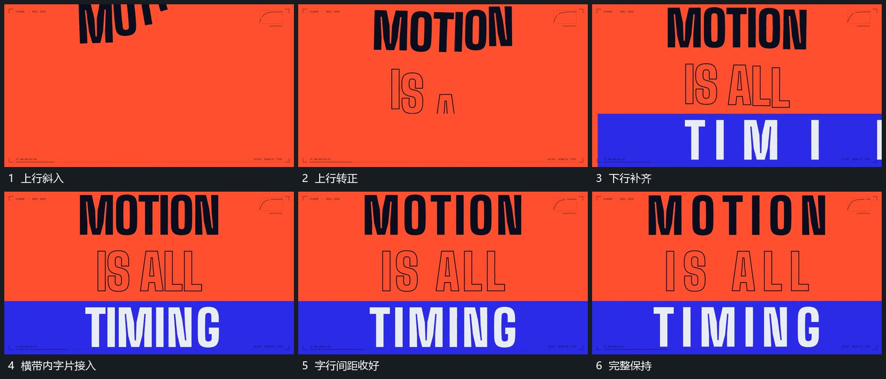

# 多行字片错峰建立横带接上最后一行

## 运动指令

先让上行字片带小转角进入并转正，再在其下方补下一行。横带从一侧接上，带内末行字片错开建立，未齐片逐步对齐共同基线；完整后各行停止大幅位移。

## 视频切片

[播放本机制的原片切片](m02.mp4)

覆盖分镜中“上行斜入”至“完整保持”的连续过程，并保留邻近的前后衔接画面；原片中交叠发生的动作一并保留。

## 分镜过程

## 组合与调整

可换成片面组，保留各行不同起点；横带和内部字片不要同时满幅闪现。
