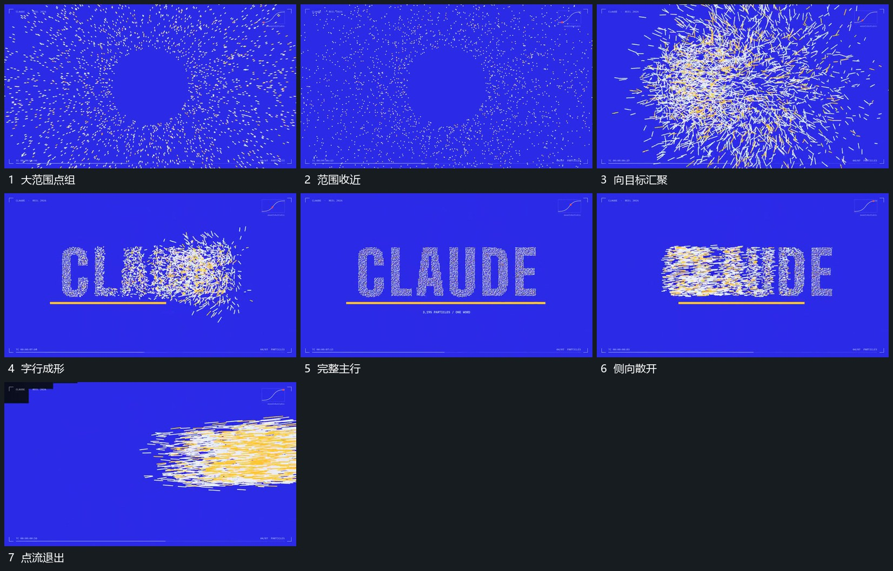

# 点组向字行位置收齐再沿侧向散开退出

## 运动指令

把分散点向同一字行范围收近，先形成部分笔段，再让剩余点补齐整行，下线在成形过程中接入。主行保持后从一侧逐步散开，点带向边外经过，尚未经过的部分仍保留字形。

## 视频切片

[播放本机制的原片切片](m04.mp4)

覆盖分镜中“大范围点组”至“点流退出”的连续过程，并保留邻近的前后衔接画面；原片中交叠发生的动作一并保留。

## 分镜过程

## 组合与调整

可换任意目标轮廓；退出有明确侧向推进，不全行同时随机消散。
