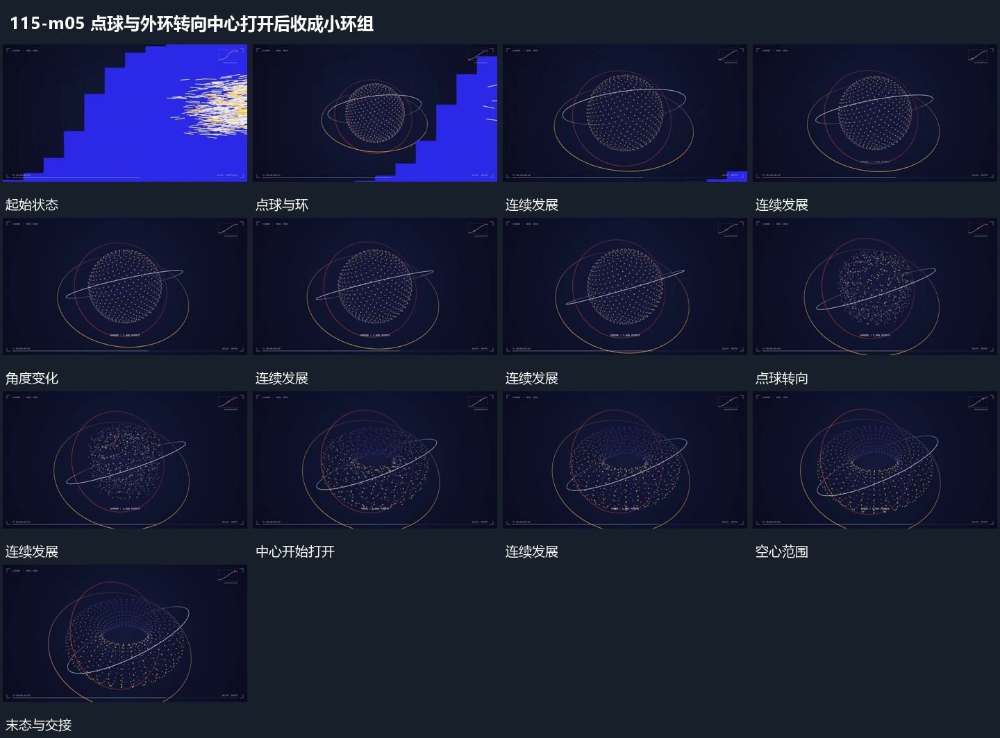

# 点球与外环转向中心打开后收成小环组

## 运动指令

点球持续转向，外部倾角环围共同中心经过。中间点逐步移向周边，球组转为空心范围，外环仍保留；空心点组形成后整体收小并向中央靠近，给下一并置范围留空。

## 视频切片

[播放本机制的原片切片](m05.mp4)

覆盖分镜中“点球与环”至“整体缩小”的连续过程，并保留邻近的前后衔接画面；原片中交叠发生的动作一并保留。

## 分镜过程

## 组合与调整

形态之间保留点组身份；中心打开与整体缩小分先后完成。
