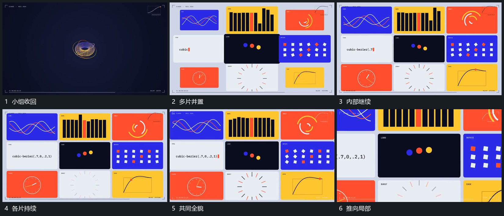

# 多片并置保留各自内部运动再推向一片

## 运动指令

围中央范围分次建立多个片面，片面排列稳定，各自内部运动继续。全貌齐全后沿一片推近，周围片边逐步越界，选中片内部保持连续；到主要范围后接新的主行。

## 视频切片

[播放本机制的原片切片](m06.mp4)

覆盖分镜中“小组收回”至“推向局部”的连续过程，并保留邻近的前后衔接画面；原片中交叠发生的动作一并保留。

## 分镜过程

## 组合与调整

可以减少片数；不用静态截图替代仍需活动的内部过程。
