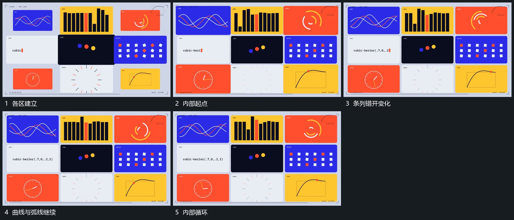

# 并行小范围各自起伏转角保持外框

## 运动指令

保持各片面边界，曲线区只改变局部高低，条列区让各条错开增高回落，圆弧区沿同一中心转向与收展。各区互不带动外框，内部动作按自身循环接续，形成一个稳定布局中的并行变化。

## 视频切片

[播放本机制的原片切片](m07.mp4)

覆盖分镜中“各区建立”至“内部循环”的连续过程，并保留邻近的前后衔接画面；原片中交叠发生的动作一并保留。

## 分镜过程

## 组合与调整

采用时只选需要的局部关系，不要求重建原片全部小区；每区仍需独立实现与预览。
