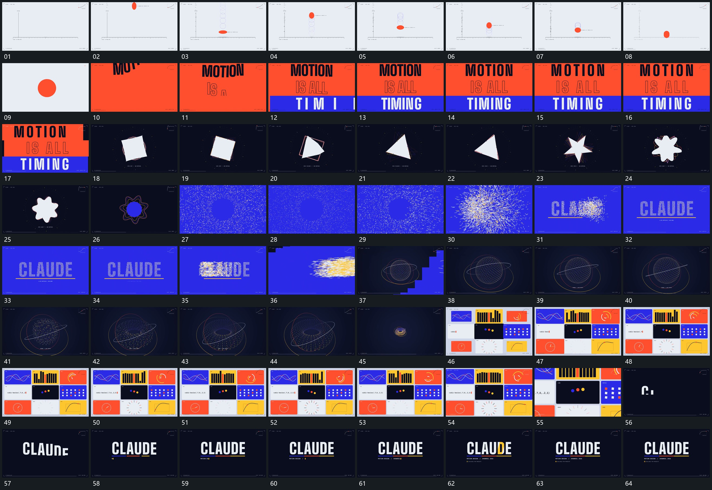

# 115｜原片运动总览

[观看完整原片](video.mp4)

## 运动总览

全片由球垂向起落压扁后恢复并逐次降低高度沿底线起落并逐次收小高度，接到多行字片错峰建立横带接上最后一行多行字片错峰建立。接着中央轮廓转角变形外围细轮廓错开跟随改变中央轮廓与外围轮廓的角度，点组向字行位置收齐再沿侧向散开退出从分散点汇成主行再沿侧向散开退出。

空间段点球与外环转向中心打开后收成小环组让点球与外环共同转向，中间打开后收成较小环组。多片并置保留各自内部运动再推向一片退为多个片面并置，各片内部继续运动，再推向局部；其中的曲线和条列运动可按并行小范围各自起伏转角保持外框的独立变化关系采用。末尾多行字片错峰建立横带接上最后一行重新建立主行，附属行与下线先后补齐。

## 完整运动段落

以下按原片中的出现顺序引用。建立、内部发展及完成反馈放在同一段中；同时发生的局部动作与运镜写在同一份指令里。不同段之间可以是连续接管，也可以是直接切换，不能仅凭条目相邻认定可直接拼接。重复出现的同类运动采用一次连续代表范围，切片不以逐段无缝覆盖整片为目标。

1. [球垂向起落压扁后恢复并逐次降低高度](mechanisms/m01.md)：垂向起落逐次收小

2. [多行字片错峰建立横带接上最后一行](mechanisms/m02.md)：错峰入场下层接续

3. [中央轮廓转角变形外围细轮廓错开跟随](mechanisms/m03.md)：中央先变外围后跟上

4. [点组向字行位置收齐再沿侧向散开退出](mechanisms/m04.md)：汇聚成行侧向回收

5. [点球与外环转向中心打开后收成小环组](mechanisms/m05.md)：转向打开中部缩回

6. [多片错峰补成并置集合，各自持续运动后推向选片](mechanisms/m08.md)：少量片面先在不同位置建立，再逐项补齐为网格集合；各片内部起伏和转向同时持续，外框保持稳定，最后推向选中片完成接管。

切片保留起始准备、必要内部停顿和完成或明确交接；首尾省略无新发展的等待，持续运动不要求人为停住。以上基于真实源帧序列和重点边界核对，不等同于全片连续声画审片。

## 完整64宫格

