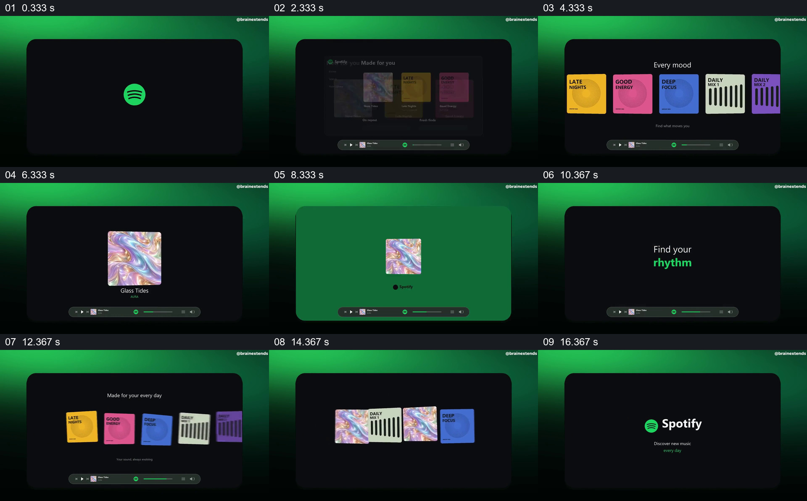

# 让一张封面从推荐集合走到播放，再回到集合

- 作品：案例 111。
- 原片范围：00:00.000–00:18.065（源时间，含起点、不含终点）；[完整原片](../video.mp4)｜[本卡片段](../video.mp4)。复用完整原片和同范围分镜。
- 观察方式与未确认范围：核看全片 64 帧总览和本卡九宫格；未独立连续原速观看或听审，抽帧间运动、精确节奏、声音和同步未确认。价值判断为作品分析，跨项目迁移尚未实测。

## 原画面具体怎样设计

绿色渐变环境包围一块黑色圆角窗口，中央先是绿色标志和“Discover new music”。随后窗口里出现推荐页面，彩色专辑封面与黑色导航组成一个小界面，底部播放条也建立起来。页面退让后，几张封面在同一黑色空间中并列，随后出现以颜色区分不同心情的另一排卡片。

接着搜索框和一条结果占据中央，一张虹彩封面被单独放大，歌名及播放按钮在其旁出现；底部播放条一直留在黑色窗口下方。封面随后被放到绿色页中，再在黑色窗口里扩大成单张主视觉；“Find your rhythm”取代封面成为中央文字。其后多色封面重新排成一列，最后几张图向中央聚拢并让位于品牌名和结束文字。

## 为什么这样设计，好在哪里

固定黑色窗口及播放条把不同页面和图形状态装在同一空间；前后反复出现的虹彩封面是可追踪的具体对象，使从一堆选择转到单项、再回到选择不显得只是换了几张无关海报。单项封面被放大时，其余内容退开，观众可先认出被选中的东西；末段重新并列再汇集，给品牌收尾一个可见依据。

这是画面分析，屏幕交互与个性化推荐并未由原片证明。

## 可直接使用的创意指令

当项目有多份真实作品、商品或内容可供选择时，先在统一容器里建立可辨的候选集合，再明确挑出其中一个，让它获得更大的观察空间和必要的名称；在这一过程中保留一个稳定的容器、导航或状态栏。单项展示完成后，把它重新放回与其他候选相关的集合，以集合或身份标识收束。

画幅、内容类别、封面数量和容器可调整；关键是同一项能在集合、单项和回看中被认出。若播放或搜索只是演示，应明确标注，长文本不宜照搬快速切换。
